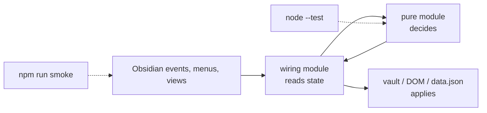

# Code style and review checklist

How code in this repo is written, so it stays easy for a person to maintain. Applies to every plugin and to
`tools/`. The hard conventions (layout, naming, styles, safety) are in the root `CLAUDE.md`; this file is the *why*
and the review checklist.

## Principles

- **KISS**: the plainest code that does the job. A function, not a class, when there is no state. No option,
  parameter or abstraction "for later": add it when a second caller needs it.
- **DRY, with judgement**: the same logic in two places is a bug waiting to happen; extract it. Two lines that only
  *look* alike are not duplication: don't force a shared helper on them.
- **Refactor when it pays**: a refactor must remove duplication, fix a smell that misleads the reader (a misleading
  name, dead code) or make the next change easier. Renaming or reshuffling for taste alone is not worth the diff.
- **Pure core, thin wiring**: decisions (parse, plan, validate, combine, format text) go in modules that don't import
  `obsidian`, with unit tests. The Obsidian side reads state, calls them and applies the result.
- **One path for one job**: e.g. every tag write in `tag-everything` goes through `enqueue` → `applyOne`; a new
  feature adds a planner, not a second write path.

## Readability

- **Names say what, not how**: `searchMatches()`, `resetSearch()`, `cleanTagList()`. A helper used for two kinds of
  things gets a neutral name (`nextId(items, "t")`, not `nextGroupId`).
- **Small functions**, one level of abstraction each. A long render function is fine when it reads top to bottom;
  split it when a part has a name of its own.
- **Files by topic**, roughly under 500 lines. A big view keeps its own rendering; its dialogs and shared DOM helpers
  go to their own modules (`dialogs.ts`, `ui.ts`).
- **Types at the boundaries**: data read from disk or `data.json` is `unknown` until a `normalize*` function repairs
  it; inside, types are trusted. No `any`; a cast only for an internal Obsidian API, with a narrow interface.
- **Immutability for state shared with the UI**: pure functions return new arrays (`groups.ts`, `tabs.ts`).

## Comments

Few, and only where the code can't say it:

- a **doc comment** (`/** … */`) on every exported function, class and non-obvious member: what it does, what it
  returns in the edge cases (`null when …`, `throws on …`);
- a **why** comment before a non-obvious choice: an order that matters, a workaround, a trap of the Obsidian API
  (`// Not "open": View.open(containerEl) is an internal Obsidian method that this would shadow.`);
- a short **header** on each module: its role and whether it is pure.

No comment that repeats the code (`// increment i`), no commented-out code, no changelog in comments (git has it).

## Errors

- `try/catch` around vault I/O, internal APIs and DOM tweaks; log with the `[<id>]` prefix (`console.warn` /
  `console.error`), tell the user with one `Notice`.
- One failing item never stops a batch; failures are collected and reported once.
- Refuse rather than guess when data could be lost (unparsable file, name clash).

## Review checklist

Run through it on every change, and once in a while over a whole plugin (see `docs/workflow.md` → *D. Code review*).

1. Duplication: the same logic (not just similar lines) in two places? Extract it to the module that owns the topic.
2. Dead code: exports or methods nobody calls (grep them), unused CSS classes, stale comments.
3. Names: does each name still say what the thing does?
4. Size: a file over ~500 lines, or a function you can't summarize in one sentence?
5. Purity: logic that could be pure and tested, but sits in a module importing `obsidian`?
6. Comments: missing *why*, or comments that repeat the code?
7. Conventions from `CLAUDE.md`: the four UI surfaces (explorer, context menu, one panel with tabs, settings for options only; nothing new elsewhere), UI says it is the plugin (submenu, `<Name>: ` notices), `register*` for everything, `instanceof` checks, theme variables, `[<id>]` logs.
8. Docs: does `docs/` (user guide, architecture, format) still describe the code? See `docs/README.md`.
