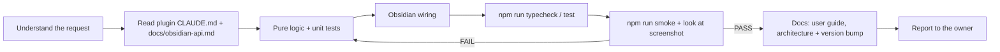

# Workflow: creating and improving plugins

Playbooks Claude (or anyone) follows to work on this repo without supervision. The definition of done is in
`CLAUDE.md`; this file is the *how*.



## A. New plugin

1. **Pin down the request** in 3 to 5 bullet points: what the user does (menu, command, view, setting), what the
   plugin reads and writes, what must never happen (data loss, renames...). Decide the open questions with
   sensible defaults and list them in the report; ask only when a choice is irreversible (file format, renames).
2. **Pick an id**: lower-case words joined by `-`, no "obsidian", no third-party brand. Check `npm run status`
   that it is free.
3. **Scaffold**: `npm run new -- <id> --name "Name" --description "One sentence."`
   This gives `src/main.ts` (command + settings tab), `src/core.ts` (pure, tested), `tests/core.test.ts`,
   `tests/smoke.js`, `styles.css`, `README.md`. Run `npm run smoke -- <id>` once: it must PASS before you change
   anything, which proves the toolchain works.
4. **Look for prior art** in `plugins/*/src`: settings tab, modal with autocomplete (`tag-everything/src/modal.ts`),
   side view (`view.ts`), explorer decoration (`badges.ts`), `.ts`/dot-folder I/O through the adapter (`store.ts`),
   in-memory index kept in sync with vault events (`index.ts`). Copy the pattern, not the plugin.
5. **Write the pure core first** (`src/<topic>.ts`, no `obsidian` import) with `tests/<topic>.test.ts`. Anything
   that parses, formats, plans a change or computes paths belongs here.
6. **Wire it into Obsidian** in `src/main.ts` and small UI modules. Grep `node_modules/obsidian/obsidian.d.ts`
   for every API you use. Read the *traps* section of `docs/obsidian-api.md`.
7. **Fixture vault** if the plugin works on files: `tests/fixtures/vault/` with the smallest set of files that
   exercises it (add `.obsidian/app.json` with `{"showUnsupportedFiles": true}` if it needs non-note files).
8. **Smoke test**: replace the template `tests/smoke.js` with checks that drive the real behaviour (call the
   plugin's methods, run its commands, open its views, read back the vault). See `docs/testing.md`. Finish by
   opening the main UI so the screenshot shows it.
9. **Iterate** until `npm run typecheck`, `npm test -- <id>` and `npm run smoke -- <id>` are all green and the
   screenshot looks right (theme colours, no overflow, nothing hidden behind a modal).
10. **Document** (map: `docs/README.md`): `README.md` (pitch, install), `docs/user-guide.md` (every feature,
    command, setting, limit), `docs/architecture.md` (layers, flows as Mermaid diagrams, module reference) and
    `CLAUDE.md` (where to change what, invariants, tests, traps). Add the plugin to the table in the root
    `CLAUDE.md` and the list in `README.md`.
11. **Report** and offer to deploy: `npm run deploy -- <id>` into the vault the owner names, then
    *Settings → Community plugins → enable*.

## B. Improve an existing plugin

1. Read `plugins/<id>/CLAUDE.md` (spec, invariants), then the files it points to.
2. **Baseline**: `npm test -- <id>` before changing anything (no smoke: it runs once at the end, see
   `docs/testing.md` → *Test budget*). If the baseline fails, say so and fix or report that first; never build on a
   red baseline silently.
3. **Bug**: reproduce it first, as a failing unit test (pure logic) or smoke `check()` (wiring/UI). Then fix.
   **Feature**: add the tests with the code.
4. Keep the plugin's **invariants** (listed in its `CLAUDE.md`). A change to a stored format must stay readable by
   the previous version or come with a migration that is safe to re-run.
5. Run the definition of done. Bump `manifest.json` `version`.
6. Update the docs where behaviour, settings, modules or format changed (`docs/README.md` → *When to update
   what*). Follow `docs/code-style.md`: reuse the shared helpers, keep one path per job.

## C. Debugging a failure

- **Smoke FAIL with an exception**: the stack shows `plugin:<id>:<line>`, lines of `dist/<id>/main.js`
  (not minified: open it). The usual suspects are in `docs/obsidian-api.md` → *Traps*.
- **Need to poke around**: `npm run smoke -- <id> --keep` leaves the throwaway profile and vault in `%TEMP%`
  (path printed). Add temporary `check("debug", true, JSON.stringify(x))` lines to print values.
- **Plugin does not load**: the smoke run prints `NOT loaded` plus the console error: usually a top-level throw,
  a missing `export default`, or a manifest problem (`loadPlugin` in `tools/lib.mjs` validates the manifest).
- **Type errors in a correct call**: the `obsidian` types may be older than the app; check `obsidian.d.ts`, then
  cast narrowly (pattern in `docs/obsidian-api.md`).

## D. Code review / clean-up

For a "review the code" request, or once in a while over a whole plugin. Fix directly; ask only for a product
decision.

1. **Baseline**: `npm run typecheck`, `npm test -- <id>` green before touching anything.
2. **Read every file** of the plugin (and `tools/` if in scope) against the checklist in `docs/code-style.md`. Note
   findings first, then decide: a refactor that removes nearly nothing is skipped.
3. Dead code: grep each export / public method for callers; unused CSS classes against `src/` and `tests/`.
4. Fix in small steps, `npm run typecheck` + `npm test -- <id>` after each. A behaviour-neutral refactor needs no new
   test; a merged helper whose callers differed gets one (and check it fails when the helper is broken).
5. `npm run smoke -- <id>` once at the end (UI touched), look at the screenshot.
6. Docs: walk `docs/README.md` → *When to update what*; module renames and moves land in `docs/architecture.md`.
7. Patch version bump; report what changed, what was left as is and why.

## E. Releasing to the owner's vault (only when asked)

```powershell
npm run deploy -- <id>                 # open vault; or --vault Perso / --vault "C:\path"
npm run status                         # installed = built, current = yes
```

First deploy: *Settings → Community plugins → enable*. Update: disable + enable, or *Reload app without saving*.
`deploy` keeps the previous build in `backups/` and never touches the plugin's `data.json` (its settings).
