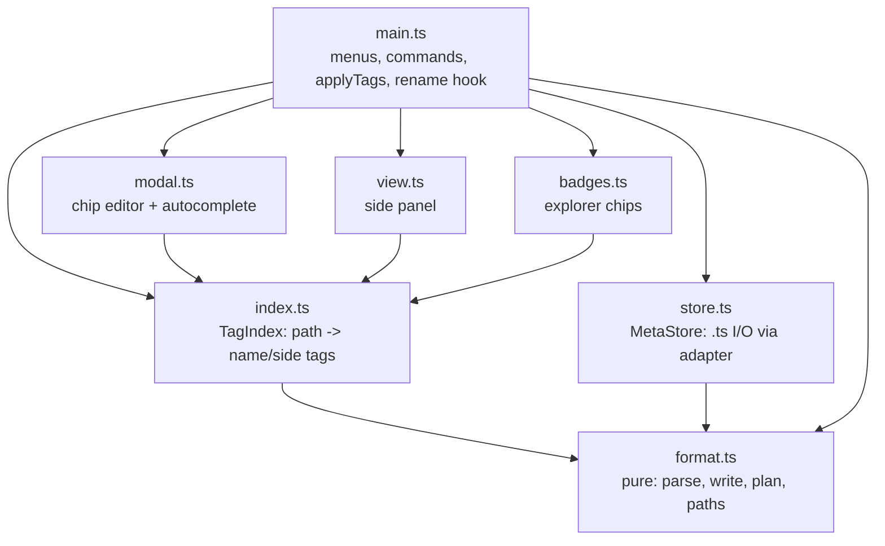

# TagEverything: notes for Claude

Read the root `CLAUDE.md` first. User-facing description: `README.md`. Storage format spec: `docs/format.md`.

## What it does

Tag any file or folder of a vault from the file explorer (right-click, multi-selection, command), with tags stored
in the file name (`report[tax receipt].pdf`) or in `.ts` sidecar JSON files; mostly compatible with TagSpaces. A side panel lists every tag and filters by tags (AND); badges show tags in the explorer.

## Architecture

| File | Role |
|---|---|
| `src/format.ts` | **Pure** format logic: `parseNameTags`, `setNameTags`, `normalizeTag`, sidecar parse/merge/serialize, `.ts` paths, `planTags`, `mergeEdit`. Unit-tested. No `obsidian` import. |
| `src/index.ts` | `TagIndex` (extends `Events`, fires `"changed"`): path → `{ name, side }`. Name tags follow vault events live; sidecars are scanned on `rebuild()` (startup, command, panel ↻) with 8 concurrent folder reads. |
| `src/store.ts` | `MetaStore`: read / write sidecar tags, move a file's sidecar + thumbnail. Refuses to overwrite unparsable JSON. |
| `src/main.ts` | Plugin wiring. `applyTags(items, {added, removed})` is the single write path (modal, tests, future commands): per item it re-reads the sidecar, merges, plans, renames first, then writes the sidecar. `ownRenames` keeps its own renames away from the rename hook. |
| `src/modal.ts` | `TagEditorModal`: chips; partial chips (`3/5`) in multi-edit; filename preview; returns a `TagEdit` diff, not a full list, so multi-edit keeps each item's other tags. |
| `src/view.ts` | `TagEverythingView` (`tag-everything-view`): tag cloud with counts, AND filter, results (max 500), click opens (non-notes in the system app, folders revealed), right-click shows the file menu. |
| `src/badges.ts` | Chips in the core explorer through its internal `fileItems` (see `docs/obsidian-api.md`). |
| `src/settings.ts` | `storage` (`filename` \| `sidecar`), `lowercase`, `followRenames`, `showBadges`, `badgeScope`, `maxBadges`. |

## Invariants (keep them)

1. A file's tags = name tags ∪ sidecar tags. A folder's tags = `tsm.json` tags only.
2. The format stays compatible with `docs/format.md`. Never write `tsi.json` / `tsl.json`.
3. Never lose a tag: rename before writing the sidecar; a failure part-way can leave a tag in both places, never in
   neither.
4. Never overwrite metadata that wasn't parsed. Never overwrite an existing file on rename or move.
5. One failing item never stops a batch; failures are listed in one `Notice`.
6. Renames go through `fileManager.renameFile` so links in notes are updated.

## Tests

- `tests/format.test.ts`: the format, including round-trips and refusals.
- `tests/smoke.js` + `tests/fixtures/vault/`: 28 in-app checks (menus, index, filename and sidecar modes, folders,
  moves, multi-edit, refusal, panel, badges, modal). Run `npm run smoke -- tag-everything`.
- `tools/check-vault.ts "<vault>"`: **read-only**; every tagged name in a real vault must round-trip unchanged
  (2026-11-20 on the owner's vault: 9 500 files, 70 tagged names, 0 problems). Run it after any change to
  `parseNameTags` / `setNameTags`.

## Known limits / ideas not done

- `.ts` changes made outside Obsidian need a rebuild (no watcher on dot-folders). A file-system watcher on the
  vault base path (desktop `fs.watch`) would fix it.
- Badges rely on internal explorer markup.
- The owner's main vault has *Detect all file extensions* off, so PDFs and Office files are invisible to the plugin
  until they turn it on.
- Ideas: rename / merge a tag everywhere; tag groups and colours editable in settings; tag search in the quick
  switcher; frontmatter `tags` sync for notes.
