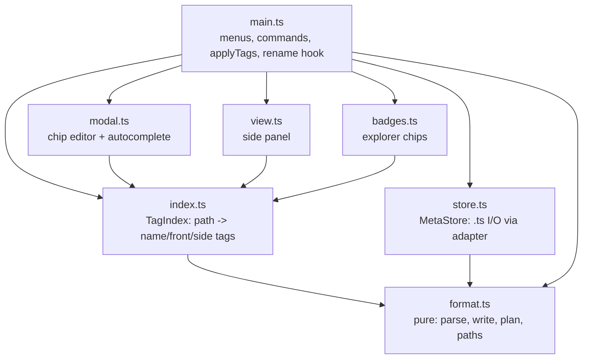

# TagEverything: notes for Claude

Read the root `CLAUDE.md` first. User-facing description: `README.md`. Storage format spec: `docs/format.md`.

## What it does

Tag any file or folder of a vault from the file explorer (right-click, multi-selection, command). Markdown notes:
tags in the frontmatter `tags` property (Obsidian-native, setting `noteTagsInFrontmatter`, on by default). Other
files: tags in the file name (`report[tax receipt].pdf`) or in `.ts` sidecar JSON files; mostly compatible with
TagSpaces. Reading always merges name + frontmatter + sidecar tags. A side panel lists every tag and filters by
tags (AND); badges show tags in the explorer.

## Architecture

| File | Role |
|---|---|
| `src/format.ts` | **Pure** format logic: `parseNameTags`, `setNameTags`, `normalizeTag` (+ `nested` for frontmatter), `assertWritable`, `frontmatterTags` / `setFrontmatterTags`, sidecar parse/merge/serialize, `.ts` paths, `planTags` (targets `filename` \| `sidecar` \| `frontmatter`), `mergeEdit`. Unit-tested. No `obsidian` import. |
| `src/index.ts` | `TagIndex` (extends `Events`, fires `"changed"`): path → `{ name, front, side }`. Name tags follow vault events live; frontmatter tags follow `metadataCache` `"changed"` (wired in `main.ts`) and are read from the cache at the end of `rebuild()`; sidecars are scanned on `rebuild()` (startup, command, panel ↻) with 8 concurrent folder reads. |
| `src/store.ts` | `MetaStore`: read / write sidecar tags, move a file's sidecar + thumbnail. Refuses to overwrite unparsable JSON. |
| `src/main.ts` | Plugin wiring. `applyTags(items, {added, removed})` is the single write path (modal, tests, future commands): per item it re-reads the sidecar and, for a note, the frontmatter **from the file** (`readFrontTags`: the cache can lag), merges, plans with `targetFor(file, settings)`, checks new tags with `assertWritable`, renames first, then writes the frontmatter (`processFrontMatter`), then the sidecar. `ownRenames` keeps its own renames away from the rename hook. |
| `src/modal.ts` | `TagEditorModal`: chips; partial chips (`3/5`) in multi-edit; filename preview; returns a `TagEdit` diff, not a full list, so multi-edit keeps each item's other tags. |
| `src/view.ts` | `TagEverythingView` (`tag-everything-view`): tag cloud with counts, sized by use (`--tag-everything-weight` from `cloud.ts`), AND filter, results (max 500), click opens (non-notes in the system app, folders revealed), right-click shows the file menu. |
| `src/cloud.ts` | **Pure** `cloudWeight` / `cloudWeights`: 0..1 per tag, log scale, 5 levels, relative to the tags shown. `styles.css` maps it to `--font-ui-small × (1 + 0.4 × weight)`: floor = normal chip, ceiling = 1.4×. |
| `src/colors.ts` | **Pure** `autoColor(tag)`: one of 8 theme colours (`var(--color-*)`), FNV-1a hash of the root of the tag, lower-cased (nested tags share their root colour). `TagIndex.colorFor(tag)` = sidecar colour, else `autoColor` when `autoColors` is on (`colorOf` stays the sidecar colour only). |
| `src/badges.ts` | Chips in the core explorer through its internal `fileItems` (see `docs/obsidian-api.md`). |
| `src/settings.ts` | `storage` (`filename` \| `sidecar`), `noteTagsInFrontmatter`, `lowercase`, `followRenames`, `showBadges`, `autoColors`, `badgeScope`, `maxBadges`; `targetFor(file, settings)` = where an item's new tags go. |

## Invariants (keep them)

1. A file's tags = name tags ∪ frontmatter tags (`.md` only) ∪ sidecar tags, whatever the settings. A folder's
   tags = `tsm.json` tags only.
2. The format stays compatible with `docs/format.md`. Never write `tsi.json` / `tsl.json`.
3. Never lose a tag: rename, then frontmatter, then sidecar. Kept tags never move between name and frontmatter; tags
   only move out of the sidecar, so a failure part-way can leave a tag in two places, never in neither.
4. Never overwrite metadata that wasn't parsed (sidecar JSON, note frontmatter YAML). Never overwrite an existing
   file on rename or move.
4b. A tag goes where it is valid: no nested tag (`a/b`) in a file name (`assertWritable`).
5. One failing item never stops a batch; failures are listed in one `Notice`.
6. Renames go through `fileManager.renameFile` so links in notes are updated.

## Tests

- `tests/format.test.ts`: the format, including frontmatter shapes, planning per target, round-trips and refusals.
- `tests/cloud.test.ts`: cloud sizing bounds, log scale, levels, monotonic.
- `tests/colors.test.ts`: automatic colours stable, case / `#` / nested roots, spread over the palette.
- `tests/smoke.js` + `tests/fixtures/vault/`: 49 in-app checks. The first part runs the name / sidecar engine on
  notes with `noteTagsInFrontmatter = false`; the "notes: frontmatter" part turns it on (merge, no rename on add,
  rename on name-tag removal, new frontmatter block, sidecar → frontmatter, live external edit, invalid YAML
  refused, PDF still renamed, nested tag refused in a name); then panel, badges, modal. Run
  `npm run smoke -- tag-everything`.
- `tools/check-vault.ts "<vault>"`: **read-only**; every tagged name in a real vault must round-trip unchanged
  (2026-11-20 on the owner's vault: 9 500 files, 70 tagged names, 0 problems). Run it after any change to
  `parseNameTags` / `setNameTags`.

## Known limits / ideas not done

- `.ts` changes made outside Obsidian need a rebuild (no watcher on dot-folders). A file-system watcher on the
  vault base path (desktop `fs.watch`) would fix it.
- Badges rely on internal explorer markup.
- The owner's main vault has *Detect all file extensions* off, so PDFs and Office files are invisible to the plugin
  until they turn it on.
- Inline `#tags` in a note's body are not read (only frontmatter): they can't be removed through a property edit.
- Ideas: rename / merge a tag everywhere; tag groups and colours editable in settings; tag search in the quick
  switcher; a command to move a note's name tags into its frontmatter (renames the note, so opt-in).
