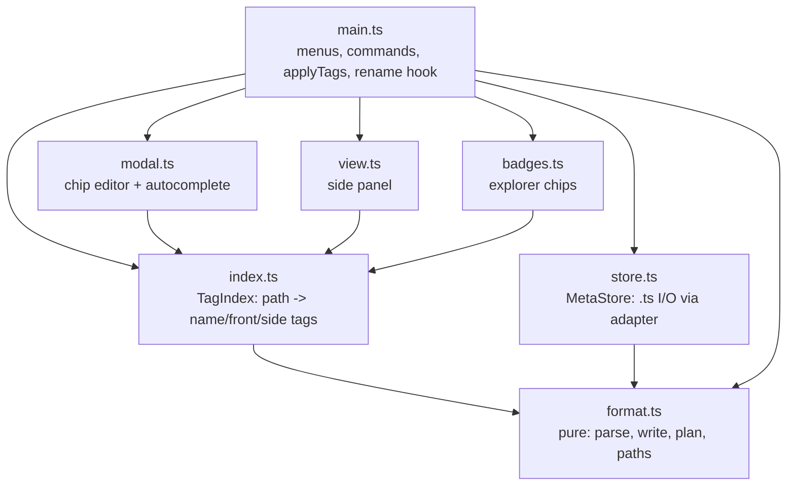

# TagEverything: notes for Claude

Read the root `CLAUDE.md` first. User-facing description: `README.md`. Storage format spec: `docs/format.md`.

## What it does

Tag any file or folder of a vault from the file explorer (right-click, multi-selection, command). Markdown notes:
tags in the frontmatter `tags` property (Obsidian-native, setting `noteTagsInFrontmatter`, on by default). Other
files: tags in the file name (`report[tax receipt].pdf`) or in `.ts` sidecar JSON files; mostly compatible with
TagSpaces. Reading always merges name + frontmatter + sidecar tags. A side panel lists every tag and filters by
tags (AND), with foldable tag groups that double as saved searches; badges show tags in the explorer.

## Architecture

| File | Role |
|---|---|
| `src/format.ts` | **Pure** format logic: `parseNameTags`, `setNameTags`, `normalizeTag` (+ `nested` for frontmatter; a `/` outside it gets a "nested tags only go in a note's frontmatter" message), `parseTagInput`, `assertWritable`, `frontmatterTags` / `setFrontmatterTags`, sidecar parse/merge/serialize, `.ts` paths, `planTags` (targets `filename` \| `sidecar` \| `frontmatter`), `mergeEdit`. Unit-tested. No `obsidian` import. |
| `src/index.ts` | `TagIndex` (extends `Events`, fires `"changed"` debounced, **only when a tag changed**): path → `{ name, front, side }` + precomputed merged `all` / `set` (`tagsOf` returns a shared read-only array, `hasTag` is O(1)); `counts()` (no argument) and `ranked()` are cached until the next change. Name tags follow vault events live (a file rename / delete touches one key, a folder its subtree); frontmatter tags follow `metadataCache` `"changed"` (wired in `main.ts`); sidecars are scanned on `rebuild()` (startup, command, panel ↻) with 8 concurrent folder reads; one bad sidecar never stops its folder; a folder moved mid-scan is re-read at its new path. **Edits during a scan are not lost**: `setSide` / `onRename` / `onDelete` also go to `scanLog`, replayed on the scan's sidecar map before the swap; names and frontmatter are then read from the vault as it is at the swap. `ready` is false until the first scan. |
| `src/store.ts` | `MetaStore`: read / write sidecar tags, move a file's sidecar + thumbnail. Refuses to overwrite unparsable JSON. |
| `src/main.ts` | Plugin wiring. `applyTags(items, {added, removed})` is the single write path (modal, tests, future commands), **queued** (`queue`: one batch at a time), progress notice past 5 items, one failure notice (`failureMessage`). Per item it refuses an item no longer in the vault (`getAbstractFileByPath(path) !== item`), re-reads the sidecar and, for a note, the frontmatter **from the file** (`readFrontTags`: the cache can lag), merges, plans with `targetFor(file, settings)`, checks new tags with `assertWritable`, renames first, then writes the frontmatter (`processFrontMatter`), then the sidecar. `ownRenames` keeps its own renames away from the rename hook. |
| `src/modal.ts` | `TagEditorModal`: chips; partial chips (`3/5`) in multi-edit; filename preview; returns a `TagEdit` diff, not a full list, so multi-edit keeps each item's other tags. Typed text goes through `parseTagInput`: invalid words stay in the box with their error (Save refuses only while invalid text is there); a separator typed **at the end** commits. A picked suggestion is checked with `normalizeTag(tag, false, allFrontmatter())` (nested tag for a non-note refused up front). |
| `src/view.ts` | `TagEverythingView` (`tag-everything-view`): tag cloud with counts, sized by use (`--tag-everything-weight` from `cloud.ts`), AND filter, results (max 500), click opens (non-notes in the system app, folders revealed), right-click shows the file menu. Results also: middle-click / Ctrl-click new tab, `hover-link` (page preview, source registered in `main.ts`), drag into a note via the internal `dragManager` (guarded). Keyboard: `clickable(el, fn)` makes chips, headers, buttons, rows focusable with Enter / Space. `getState` / `setState` persist `selected`, `activeGroup`, `filter` (`requestSaveLayout` on change); `render()` only prunes `selected` once `index.ready`. Filter: Enter selects the first chip (`data-tag`), Escape clears. Each group header has a search button (`.tag-everything-group-search`: icon + count). Tag groups: section above the cloud; every chip is draggable (`application/x-tag-everything-tag`), group headers too (`…-group`, reorder); `selectGroup(id)` sets `activeGroup` + `selected` = the group's tags in use, the selection bar then lists all the group's tags, switched-off ones `is-off`. The search is `searchExpr()` = `prune(groupExpr(active), selected)` AND the other selected tags, run by `matchPaths(expr)` (tags no item carries are pruned first, as off). `renderExpr` draws a formula as chips between `.tag-everything-op` spans (bar and group body). Groups are saved with `plugin.saveData(settings)` directly (no index `changed`). `GroupNameModal` asks for names; `FormulaModal` (+ `FormulaTagSuggest` on the word before the caret) edits a formula, `setGroupFormula(id, text)` saves it (resolved to the vault's spelling). |
| `src/formula.ts` | **Pure** tag formulas: `Expr` tree (`tag` / `and` / `or` / `not`), `parseFormula` (AND OR NOT, ET OU NON, & \| !, `!tag`, parentheses, side by side = AND, quotes; readable errors), `formatFormula` (canonical, minimal parentheses, round-trips), `evaluate`, `prune` (drop switched-off tags, NOT with them; null if nothing left), `resolveTags` (case-insensitive to the vault's spelling), `formulaTags`, `andOf` / `orOf`. |
| `src/groups.ts` | **Pure** tag groups `{ id, name, tags, collapsed, formula? }`: `addGroup` (ids `g<n>`), `renameGroup`, `deleteGroup`, `addTagsToGroup`, `removeTagFromGroup`, `setCollapsed`, `moveGroup`, `setFormula` (tags := the formula's), `groupExpr` (formula, else AND of the tags), `formulaError`, `normalizeGroups` (repairs whatever `data.json` holds, never throws; called by `normalizeSettings`). With a formula, adding a tag appends `AND tag`, removing one prunes it; an unparsable stored formula is kept as is (error shown, search falls back to AND). Immutable. A tag may be in several groups; a group may name a tag no item carries any more (shown faded, kept). |
| `src/cloud.ts` | **Pure** `cloudWeight` / `cloudWeights`: 0..1 per tag, log scale, 5 levels, relative to the tags shown. `styles.css` maps it to `--font-ui-small × (1 + 0.4 × weight)`: floor = normal chip, ceiling = 1.4×. |
| `src/colors.ts` | **Pure** `autoColor(tag)`: one of 8 theme colours (`var(--color-*)`), FNV-1a hash of the root of the tag, lower-cased (nested tags share their root colour). `TagIndex.colorFor(tag)` = sidecar colour, else `autoColor` when `autoColors` is on (`colorOf` stays the sidecar colour only). |
| `src/badges.ts` | Chips in the core explorer through its internal `fileItems` (see `docs/obsidian-api.md`). `refresh()` is keyed: `decorated` maps each row to a signature (tags, colours, limit) and only rows whose signature changed are redrawn; rows no longer tagged or detached are cleaned. |
| `src/config.ts` | **Pure** settings data: `TagEverythingSettings`, `DEFAULT_SETTINGS`, `normalizeSettings(raw)` (wrong types / out-of-range values → defaults, unknown keys kept, groups via `normalizeGroups`; never throws). `loadSettings` also survives an unreadable `data.json` (defaults + Notice). |
| `src/messages.ts` | **Pure** notice texts: `plural`, `failureMessage` (first 5, then "…and N more"), `progressMessage`. |
| `src/settings.ts` | **Declarative** settings tab (`getSettingDefinitions()`, Obsidian 1.13+, so its rows are in Obsidian's settings search; icon `tags`; re-exports `config.ts`): `storage` (`filename` \| `sidecar`), `noteTagsInFrontmatter`, `lowercase`, `followRenames`, `autoColors`, then group *File explorer*: `showBadges`, `badgeScope`, `maxBadges` (`disabled` predicates while badges are off), a hint row `visible` only when *Detect all file extensions* is off. `setControlValue` repairs the value through `normalizeSettings`, calls `refreshDomState()`, then `plugin.saveSettings()`. `groups` is edited in the panel only. `targetFor(file, settings)` = where an item's new tags go. |

## Invariants (keep them)

1. A file's tags = name tags ∪ frontmatter tags (`.md` only) ∪ sidecar tags, whatever the settings. A folder's
   tags = `tsm.json` tags only.
2. The format stays compatible with `docs/format.md`. Never write `tsi.json` / `tsl.json`.
3. Never lose a tag: rename, then frontmatter, then sidecar. Kept tags never move between name and frontmatter; tags
   only move out of the sidecar, so a failure part-way can leave a tag in two places, never in neither.
4. Never overwrite metadata that wasn't parsed (sidecar JSON, note frontmatter YAML). Never overwrite an existing
   file on rename or move.
4b. A tag goes where it is valid: no nested tag (`a/b`) in a file name (`assertWritable`).
5. One failing item never stops a batch; failures are listed in one `Notice`.
6. Renames go through `fileManager.renameFile` so links in notes are updated.

## Tests

- `tests/format.test.ts`: the format, including frontmatter shapes, planning per target, round-trips and refusals, `parseTagInput`.
- `tests/config.test.ts`: `normalizeSettings` on missing / damaged data, message texts.
- `tests/cloud.test.ts`: cloud sizing bounds, log scale, levels, monotonic.
- `tests/colors.test.ts`: automatic colours stable, case / `#` / nested roots, spread over the palette.
- `tests/groups.test.ts`: group operations, multi-membership, no mutation, reorder, loading malformed data, formulas.
- `tests/formula.test.ts`: syntax (French / English / symbols, precedence, quotes), round-trip, errors, evaluate, prune, case resolution.
- `tests/smoke.js` + `tests/fixtures/vault/`: 100 in-app checks. The first part runs the name / sidecar engine on
  notes with `noteTagsInFrontmatter = false`; the "notes: frontmatter" part turns it on (merge, no rename on add,
  rename on name-tag removal, new frontmatter block, sidecar → frontmatter, live external edit, invalid YAML
  refused, PDF still renamed, nested tag refused in a name); robustness (a sidecar edit and a folder rename during `rebuild()` are kept, two
  concurrent edits queued, an item deleted since the editor opened refused, editor keeps an invalid word and saves
  once fixed); then panel, badges (a no-op refresh keeps the DOM), settings (declarative rows indexed for search, tab icon; in the
  real settings dialog, the badges toggle disables / enables the two badge options and is saved to `data.json`), tag groups (create through the
  dialog, drag with a synthetic `DataTransfer`, fold, `data.json`, group search, switch a tag off / on; formula through the real menu and dialog: error, preview,
  rendering, search, switch-off pruning, NOT, drop = AND, × prunes), panel usability (filter + Enter, keyboard,
  saved state, group search button, draggable results, hover source), modal. It ends on the panel with a formula
  group search (notices removed) for the screenshot. Run
  `npm run smoke -- tag-everything`.
- `tools/check-vault.ts "<vault>"`: **read-only**; every tagged name in a real vault must round-trip unchanged
  (2026-11-20 on the owner's vault: 9 500 files, 70 tagged names, 0 problems). Run it after any change to
  `parseNameTags` / `setNameTags`.

## Official guidelines

Audited on 2026-11-20 (0.8.0) against the official guidelines (summary and linter how-to: root
`docs/obsidian-api.md` → *Official guidelines*). The official linter `eslint-plugin-obsidianmd` 0.6.0, run from this
folder with `ui/sentence-case` on, reports one false positive: the formula placeholder `(tag1 OR tag2) AND tag3`.
Keep it that way: computed styles via `setCssProps` (CSS variables), `instanceof TFile` and never a cast,
`.instanceOf()` for DOM nodes and events (panel and settings may be in a pop-out window), `async` / `await`.

Deliberate exceptions, each for a reason:

- `vault.adapter` for `.ts` sidecars: dot-folders are invisible to the Vault API.
- Internal APIs (explorer `fileItems`, `revealInFolder`, `openWithDefaultApp`, `dragManager`, `getConfig`): no
  public equivalent; all guarded, they degrade to doing nothing.
- No `normalizePath()` on the paths it builds: they come from vault paths Obsidian already normalized, and
  normalizing again (NFC, non-breaking spaces) could point at a different file. Nothing here is a user-typed path.
- `isDesktopOnly: true` and an unminified `main.js`: a personal desktop plugin; readable stack traces matter more.

## Known limits / ideas not done

- `.ts` changes made outside Obsidian need a rebuild (no watcher on dot-folders). A file-system watcher on the
  vault base path (desktop `fs.watch`) would fix it.
- Badges rely on internal explorer markup.
- The owner's main vault has *Detect all file extensions* off, so PDFs and Office files are invisible to the plugin
  until they turn it on.
- Inline `#tags` in a note's body are not read (only frontmatter): they can't be removed through a property edit.
- Tag groups don't follow a tag renamed outside the panel (they keep the old name, shown faded).
- Deleting a file in Obsidian leaves its `.ts` sidecar (orphan, ignored by the scan); a file created later with the
  same name would pick its tags up at the next rebuild. Not deleted on purpose (never delete metadata unasked).
- The panel re-renders on every index change even when hidden (cheap now that counts are cached).
- Ideas: rename / merge a tag everywhere; colours editable in settings; tag search in the quick
  switcher; a command to move a note's name tags into its frontmatter (renames the note, so opt-in).
