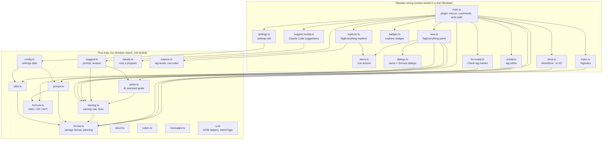
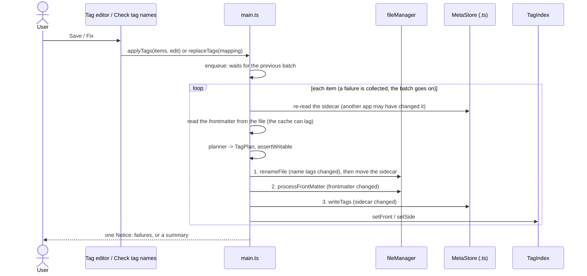
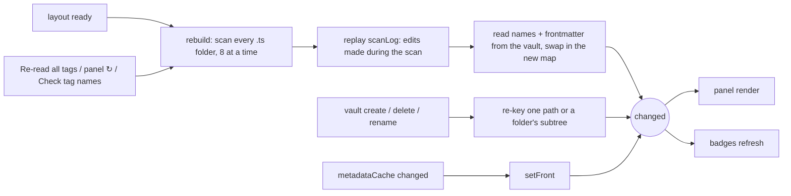
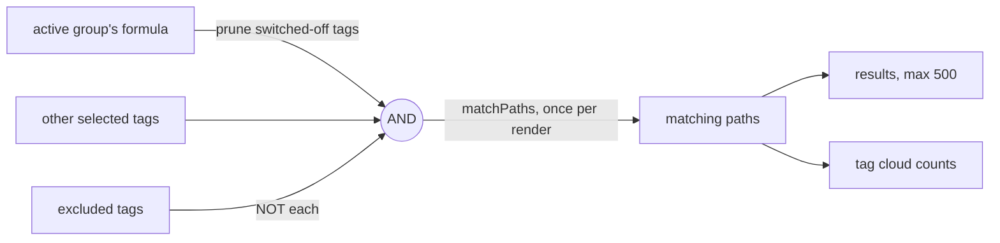
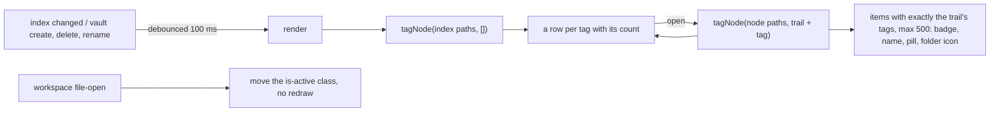

# TagEverything architecture

How the plugin is built, for whoever maintains it. What it does for users: [user-guide.md](user-guide.md). The
storage format: [format.md](format.md). The rules that must never break (invariants) and how to test:
[../CLAUDE.md](../CLAUDE.md).

## Layers

Pure modules hold every decision (parse, plan, validate, combine) and are unit-tested under `node --test`. The
Obsidian modules only read state, call the pure functions and apply the result.



## Where data lives

| Data | Where | Read / written by |
|---|---|---|
| Name tags | the file name, `report[a b].pdf` | `format.ts` (`parseNameTags`, `setNameTags`), renamed with `fileManager.renameFile` |
| Note tags | the note's frontmatter `tags` | `processFrontMatter` + `setFrontmatterTags`; followed live through `metadataCache` |
| Sidecar tags | `<folder>/.ts/<file>.json`, folder tags in `.ts/tsm.json` | `store.ts` through `vault.adapter` (dot-folders are invisible to the Vault API) |
| Settings, tag groups, bookmark tabs | `.obsidian/plugins/tag-everything/data.json` | `config.ts` (`normalizeSettings` repairs anything), saved with `saveData` |
| Panel state (search, filter, tab) | Obsidian's `workspace.json` | `view.ts` `getState` / `setState` |
| Explorer state (open tags) | Obsidian's `workspace.json` | `explorer.ts` `getState` / `setState` |
| Every item's tags, in memory | `TagIndex` | rebuilt from the three tag places, kept in sync by events |

## Writing tags: one path for every change

The tag editor (`applyTags`) and the vault fix (`replaceTags`) share one queued write path. Only the *planner*
differs: `planTags(mergeEdit(…))` for an edit, `replacePlan` for a fix.



The order rename → frontmatter → sidecar is what makes a failure part-way safe: tags only move *out of* the sidecar,
so at worst a tag is left in two places, never in none.

## Tag suggestions by Claude Code

Claude Code runs as a separate program, read-only; the plugin writes what the user keeps, through the write path
above (`addTagsEach`: one `Planner` adding each item's own tags).

```mermaid
sequenceDiagram
  actor U as User
  participant M as suggest-modal.ts
  participant P as main.ts
  participant C as claude -p (child process)
  U->>P: Suggest tags with Claude Code (folder, file or selection)
  P->>M: items (folder + files under it, max 50) and the working folder
  M->>M: suggestPrompt: items + their tags, vault tags (dictionary), naming rule
  M->>P: runClaude(folder, prompt, abort signal)
  P->>C: spawn, no shell, cwd = folder, prompt on stdin; tools Read, Glob, Grep only; --safe-mode, --json-schema
  C-->>P: JSON result (structured_output, cost, time)
  P-->>M: stdout
  M->>M: parseClaudeOutput, cleanSuggestions (rule, no tag the item has, max 5)
  U->>M: switch tags off, Add N tags
  M->>P: addTagsEach(item -> tags) -> enqueue -> applyOne
```

`--safe-mode --strict-mcp-config --system-prompt` keep the user's Claude Code setup (MCP servers, plugins, skills,
`CLAUDE.md`) out: measured on 2026-11-21, a two-note run cost $1.25 with it and $0.04 without. Closing the dialog
aborts the signal, which kills the process; a run is stopped after 10 minutes.

## The index

`TagIndex` maps each tagged path to its name, frontmatter and sidecar tags, plus the merged list and a set for O(1)
lookups. `counts()` and `ranked()` are cached until the next change. It fires `"changed"` (debounced) only when a tag
really changed; the panel and the badges redraw on it.



A scan is asynchronous: while it runs, sidecar edits, renames and deletions are both applied live and logged in
`scanLog`, then replayed on the scan's result before the swap, so nothing that happens during a scan is lost.

## The panel's search

The search is a formula (`formula.ts` `Expr`), built from the panel state by `searchExpr()`, then evaluated on every
tagged item. Tags no item carries are pruned first, as if switched off.



Every change to the search goes through `setMode(tag, …)`, `selectGroup(id)` or `resetSearch()`, then
`stateChanged()` (redraw + save the panel state).

## The explorer

`explorer.ts` draws a tree of tags from the index (stored tags only: `ownTagsOf`), not from the core explorer: the vault
loads every file whatever *Detect all file extensions* says (only the core explorer hides the unsupported ones), so
every tagged file shows. Each open node is `explore.ts` `tagNode(parent's paths, trail)`; rows use Obsidian's own tree
classes (`tree-item`, `tree-item-self`, `collapse-icon`, `tree-item-children`, `tree-item-flair`). The formula box
holds `chips` (an `Expr` drawn by `ui.ts` `renderExpr`, as the panel's group formulas) then the text being typed;
`joinFormula` makes them one formula, `treeSearch` reads it (the panel's syntax, unknown tags pruned, last valid formula
or the chips kept on a syntax error), and it filters the index paths before the root node, so the whole tree holds
only the matching items. A picked suggestion or Enter turns the text into chips (`commit`, when the whole formula
parses); a chip's × or Backspace `prune`s its tag.



## Module reference

| File | Role |
|---|---|
| `src/format.ts` | **Pure** storage format: `extensionTag(name)` (lower-cased last extension, 1-10 letters / digits, else null; derived, never written), `parseNameTags`, `setNameTags`, `normalizeTag` (+ `nested` for frontmatter; a `/` outside it gets a "nested tags only go in a note's frontmatter" message), `parseTagInput`, `splitTagInput`, `assertWritable`, `frontmatterTags` / `setFrontmatterTags`, sidecar parse / merge / serialize, `.ts` paths, `planTags` (targets `filename` \| `sidecar` \| `frontmatter`), `mergeEdit`. Tag-list helpers: `dedupe`, `sameTags`, `TagMapping` + `mapTagList` (a vault fix's tag → replacements map). |
| `src/naming.ts` | **Pure** naming rule: a tag is one lower-case word of letters / digits / marks (`\p{L}\p{N}\p{M}`), not a liaison word. `DEFAULT_STOP_WORDS` (French + English articles, prepositions, conjunctions, determiners, elided letters; deliberately not `it`, `us`, `pas`, `est`, `y`), `makeRule(stopWordsText)`, `ruleProblem` / `followsRule` / `ruleMessage`, `suggestFix` (lower-case, split on any non-word character, `/` included, so a nested tag breaks the rule and splits: `proj/alpha` → `proj`, `alpha`; liaison words dropped, an all-single-letter compound joined: `R&D` → `rd`; `[]` = drop the tag; always a fix), `parseTypedTags` (editor input: lower-cases, `/` read as `-` so it never hits the file-name error, a compound's fix goes in `rest`, a liaison word is left out, a hard error keeps the raw word; no rule → `parseTagInput`), `auditTags(counts)`, `replacePlan(state, mapping)` (each mapped tag rewritten **in the place it was**; a replacement the item already carries unmapped is not added again; one coming from two places lands in the first), `parseReplacement`. |
| `src/formula.ts` | **Pure** tag formulas: `Expr` tree (`tag` / `and` / `or` / `not`), `parseFormula` (AND OR NOT, ET OU NON, & \| !, `!tag`, parentheses, side by side = AND, quotes; readable errors), `tryParseFormula`, `formatFormula` (canonical, minimal parentheses, round-trips), `evaluate`, `requiredTags` (tags every match carries), `prune` (drop switched-off tags, NOT with them; null if nothing left), `resolveTags` (case-insensitive to the vault's spelling), `formulaTags`, `andOf` / `orOf` / `notExpr`, `toggleNot`, `replaceTagsInExpr(e, mapping)` (a tag → AND of its replacements; mapped to nothing → pruned). |
| `src/groups.ts` | **Pure** tag groups `{ id, name, tags, collapsed, formula? }`, immutable: `addGroup` (ids `g<n>` from `nextId`), `renameGroup`, `deleteGroup`, `addTagsToGroup` (with a formula: `AND tag`), `removeTagFromGroup` (prunes it from the formula), `setCollapsed`, `moveGroup`, `setFormula` (tags := the formula's), `toggleTagNot` (a group without formula gets one; an unparsable one is left alone), `groupExpr` (formula, else AND of the tags), `groupFormula` (the parsed formula, or null), `formulaError`, `replaceTagsInGroups(groups, mapping)`, `normalizeGroups` (repairs whatever `data.json` holds, never throws). Shared with tabs: `cleanName`, `cleanTagList`, `nextId(items, prefix)`. An unparsable stored formula is kept (error shown, search falls back to AND); a group may name a tag no item carries (shown faded). |
| `src/tabs.ts` | **Pure** bookmark tabs `{ id, name, tags, groups }` (`groups` = group ids), immutable: `addTab` (ids `t<n>`), `renameTab`, `deleteTab`, `setBookmark(tabs, id, "tags" \| "groups", value, on)` (adds once, at the end), `forgetGroup`, `replaceTagsInTabs`, `normalizeTabs(raw, groupIds)` (drops ids of groups that are gone). |
| `src/config.ts` | **Pure** settings data: `TagEverythingSettings` (incl. `extensionTags`, on by default), `DEFAULT_SETTINGS`, `normalizeSettings(raw)` (wrong types / out-of-range values → defaults, unknown keys kept, groups and tabs repaired; never throws). |
| `src/cloud.ts` | **Pure** `cloudWeight` / `cloudWeights`: 0..1 per tag, log scale, 5 levels, relative to the tags shown. `styles.css` maps it to `--font-ui-small × (1 + 0.4 × weight)`. |
| `src/colors.ts` | **Pure** `autoColor(tag)`: one of 8 theme colours (`var(--color-*)`), FNV-1a hash of the tag's root, lower-cased (nested tags share their root colour). |
| `src/messages.ts` | **Pure** notice texts: `PLUGIN_NAME` (menu, notices, panel and dialog titles), `plural`, `failureMessage` (first 5, then "…and N more"), `progressMessage`. |
| `src/guide.ts` | **Pure** AI assistant guide: `claudeGuide(input)` builds the `CLAUDE.md` Markdown from the settings that decide where tags go (storage, frontmatter, rule, liaison words) and the tag counts of the folder's subtree and of the vault (`tagList`: most used first, 80 shown, the rest counted); `guidePath(folder)`, `hasGuide(names)` (case-insensitive). Written by `main.ts` `writeGuide(folder)` (folder menu, root command) with `vault.create`, skipped when a guide exists: never overwritten. |
| `src/suggest.ts` | **Pure** Claude Code suggestions: `suggestPrompt(input)` (working folder, items with their stored tags, the vault's tags most used first through `guide.ts` `tagList`, the naming rule or the format's limits), `claudeArgs(model)` (print mode, JSON output, `--tools` / `--allowedTools` Read, Glob, Grep, `dontAsk`, `--safe-mode`, `--strict-mcp-config`, own system prompt, `SUGGEST_SCHEMA`), `claudeCommands(setting, home, windows)` (the setting, else `claude` then `~/.local/bin/claude.exe`), `parseClaudeOutput` (`structured_output`, else the JSON in `result`; readable errors, cost, time), `cleanSuggestions(answer, input, rule)` (asked items only, in order; normalized, rule fix, the vault's spelling without the rule, no tag the item has nor its extension, `MAX_NEW_TAGS`; `fresh` = not in the vault yet), `relativeTo`, `commonFolder`, `MAX_SUGGEST_ITEMS`. |
| `src/claude.ts` | Runs a program, no `obsidian` import (the `spawn` is passed in): `runProcess(spawn, command, args, { cwd, input, timeoutMs, signal })` (no shell; stdin written then closed; stdout on exit 0, the end of stderr otherwise; timeout and abort kill it), `NotFoundError` (ENOENT), `runFirstFound` (next command while not found). Unit-tested with real `node` processes. |
| `src/ui.ts` | DOM helpers shared by the panel, dialogs, editor, badges and explorer (no `obsidian` import): `clickable` (Enter / Space like a click), `isNode` (pop-out safe), `paintTag` (sets `--tag-everything-color`), `matchTags` (autocomplete ranking, unit-tested), `renderTagSuggestion`, `onEnter`, `renderExpr` (a formula as chips between AND / OR / NOT and the parentheses it needs: panel groups and search, explorer box). |
| `src/index.ts` | `TagIndex` (see *The index*): `get` (name, front, side, `ext`), `tagsOf` (extension tag first, then the stored ones; shared read-only array), `ownTagsOf` (stored tags only: what an edit can change), `setExtensionTags(on)` (from `saveSettings`), `hasTag`, `colorOf` (sidecar colour) / `colorFor` (sidecar, else `autoColor` when `autoColors` is on), `paths`, `size`, `counts(paths?, own?)` (`own`: no extension tags; *Check tag names* and the guide), `ranked()`, `setSide`, `setFront`, `onCreate` / `onDelete` / `onRename`, `rebuild()`, `ready` (false until the first scan). `cachedFrontTags(app, file)` reads a note's tags from the metadata cache. |
| `src/store.ts` | `MetaStore`: `metaPathOf(item)`, read / write sidecar tags (refuses to overwrite unparsable JSON; no file created for an empty list), `moveFileMeta` (sidecar + thumbnail; never overwrites, handles case-only renames). |
| `src/main.ts` | Plugin wiring: menus (`file-menu`, `files-menu`: `addPluginMenu` puts the entries in one *TagEverything* submenu through the internal `setSubmenu`, flat and prefixed if it is missing; *Edit tags* on every item but the vault root, the guide on folders, *Show in the file explorer* from the panel and the explorer), commands, ribbon (panel, explorer), `openView` / `openExplorer` (one `revealView(type, side)`), rename hook (`ownRenames` keeps its own renames away from it), `rule` (cached `NamingRule`, null when the rule is off), `reindex()`, `checkTagNames()`, `writeGuide(folder)` (AI assistant guide, src/guide.ts), `suggestTags(selection)` (items and working folder, opens `TagSuggestModal`), `runClaude(folder, prompt, signal)` (Node's `child_process` / `os` through Electron's `require`, cwd from `FileSystemAdapter.getBasePath()`; a public field so the smoke test can fake it), `addTagsEach(map)` (each item its own added tags, rule-breaking ones left out), and the write path: `applyTags` (refuses the whole edit when an **added** tag breaks the rule; tags already on an item are never checked) and `replaceTags` (finds the items through the index, snapshots each open panel's search, runs the batch, then maps `settings.groups` / `settings.tabs` and gives each panel its search back mapped), both through `enqueue` → `applyNow` (progress notice past 5 items, one failure notice) → `applyOne` (refuses an item no longer in the vault, re-reads sidecar and frontmatter, plans, `assertWritable`, rename → frontmatter → sidecar). |
| `src/modal.ts` | `TagEditorModal`: chips; partial chips (`3/5`) in multi-edit; filename preview; returns a `TagEdit` diff (`added`, `removed`), not a full list, so multi-edit keeps each item's other tags. Typed text goes through `parseTypedTags`: invalid words stay in the box with their error, a compound breaking the rule is replaced in the box by its fix, a liaison word is left out; `commitInput` returns false while anything is left, so Save waits; a separator typed at the end commits. Suggestions (`matchTags`) hide tags breaking the rule; a picked one is checked with `normalizeTag` and `ruleMessage`. `describe(items)` names a batch in notices. |
| `src/suggest-modal.ts` | `TagSuggestModal`: builds the `SuggestInput` from the index and settings, calls `plugin.runClaude`, then one row per item (name, path, current tags, suggested chips `is-selected` to switch off, `is-new` for tags the vault lacks); *Add N tags* → `plugin.addTagsEach(chosen())`. Errors (not found, not JSON, Claude Code's own) replace the list; `onClose` aborts the run. `done` resolves once the answer or the error is shown (smoke test). |
| `src/fix-modal.ts` | `TagFixModal` (*Check tag names*): `auditTags` over `index.counts()`, one row per tag (checkbox, chip, ×count, problem, editable fix with `data-tag`, row error); rows without obvious fix start unchecked; typing a fix ticks it; *Fix N tags* is disabled while a checked fix breaks the rule. `fix()` → `plugin.replaceTags(mapping)`. Works with the rule off too (configured liaison words). |
| `src/view.ts` | `TagEverythingView`: tag cloud, search bar, groups, bookmark tabs, results. State `selected`, `excluded`, `activeGroup`, `filter`, `tab` (persisted; `render()` only prunes `selected` / `excluded` once `index.ready`). `searchExpr()` / `searchMatches()` / `matchPaths(expr)`; `setMode`, `toggle`, `selectGroup`, `selectOnly`, `resetSearch`, `stateChanged`. Groups and tabs saved by `save({ groups?, tabs? })` straight to `data.json`. `renderExpr` draws a formula as chips between `.tag-everything-op` spans. Drag and drop: chips carry `application/x-tag-everything-tag`, group headers `…-group` (`dropZone`). Results: the extension tag as a chip in place of the file icon (`.tag-everything-result-ext`), the other tags below, at most `MAX_RESULTS` (500, shared with the explorer); the row's actions come from `items.ts` `wireItemRow`. Public for the smoke test: `createGroup`, `createTab`, `showTab`, `selectGroup`, `setGroupFormula`, `editFormula`, `addToGroup`, `searchSnapshot`, `replaceTags`. |
| `src/items.ts` | What a file or folder row does in the panel and the explorer: `revealInExplorer(app, item)` (the internal `revealInFolder`: the item in its real place in the file explorer), `openItem(app, item, evt)` (non-notes in the system app through the internal `openWithDefaultApp`, Ctrl/Cmd = new tab, a folder revealed in the core explorer) and `wireItemRow(view, row, item, activate?)` (click / Enter = `activate`, default `openItem`; middle click; `file-menu` on right-click; `hover-link` with the view's type as source; drag into a note through the internal `dragManager`). |
| `src/explore.ts` | **Pure** explorer logic: `tagNode(paths, tagsOf, trail)` (`paths` carrying every tag of the trail, the other tags they carry with per-item counts by name = the branches, `items` carrying exactly the trail's tags = the files; none at the root), `compareNames` (`Intl.Collator`, numeric, case / accents ignored), `compareItems` (folders first), `joinFormula(chips, typed)` (the box's chips in parentheses, then the text typed), `treeSearch(text, known, last)` (the formula box: `parsed` / `expr` applied / `problem`). |
| `src/explorer.ts` | `TagExplorerView` (`tag-everything-explorer`, left sidebar, `plugin.openExplorer()`, icon `EXPLORER_ICON` = `EXPLORER_ICON_SVG` registered with `addIcon`: Lucide's folder-tree with tags): state `expanded` (open nodes as trails, persisted, keyed by `keyOf(trail)`), `activePath`, `chips` / `query` / `parsed` / `applied` (the formula box, not persisted; `FormulaTagSuggest` completes it and its `onPick` runs `commit`; `renderChips` (× = `removeChip`, Backspace on an empty box the last tag); Enter = `openRequired`: the trail of `requiredTags`, Escape clears). `renderNode` draws a node's tag rows (`data-tag`, `data-trail`, arrow, tag icon in its colour, count in the flair; open ones drawn inside `.tree-item-children` from the node's paths) then its items; `itemRow`: invisible arrow (alignment), extension badge or icon, name (basename after a badge), flair: `plugin.badges.addPill` (tag count, hover list) and the folder icon (tooltip = real folder, click = `revealInExplorer`). `file-open` → `highlight` (class only). Redraws debounced on index and vault events, scroll kept. Public for the smoke test: `toggle(trail)`. |
| `src/dialogs.ts` | `NameModal` (group or tab name) and `FormulaModal` (+ `FormulaTagSuggest`, exported for the explorer's box: completes the word before the caret from live `tags()` / `count()`, then `onPick?.()`; live preview: canonical formula and item count, or the error). Shared footer `addSubmitButtons`: Cancel / Save, Enter submits, an error from `done` keeps the dialog open. |
| `src/settings.ts` | Declarative settings tab (`getSettingDefinitions()`, Obsidian 1.13+, rows in Obsidian's settings search): storage, frontmatter, naming rule + liaison words (disabled while the rule is off), lower-case (disabled while the rule is on), renames, colours; group *File explorer* (badges; a hint row visible only when *Detect all file extensions* is off); group *Tag maintenance* (two action rows). `setControlValue` repairs the value through `normalizeSettings`, `refreshDomState()`, saves. `groups` and `tabs` are never written by a control (`PANEL_KEYS`). `targetFor(file, settings)` = where an item's new tags go. |
| `src/badges.ts` | `ExplorerBadges`: chips in the core explorer through its internal `fileItems`: the extension tag prepended **before** the name (`.tag-everything-ext`; the row gets `.tag-everything-has-ext`, which hides Obsidian's `.nav-file-tag`), a round pill after it (`.tag-everything-count`) with the number of stored tags. `addPill(host, tags)` (also used by the explorer's rows): hovering (or clicking) the pill opens one `.tag-everything-badge-list` in the page body (`position: fixed`, so the explorer's scroll container does not clip it; flipped above near the window bottom), the tags one per line, clickable; it closes 200 ms after the mouse leaves both. `refresh()` is keyed: each row has a signature (extension, tags, colours) and only changed rows are redrawn; rows no longer tagged or detached are cleaned. |
| `styles.css` | Theme variables only, every class prefixed `tag-everything-`. Chip colour: `--tag-everything-color`; cloud size: `--tag-everything-weight`. |
