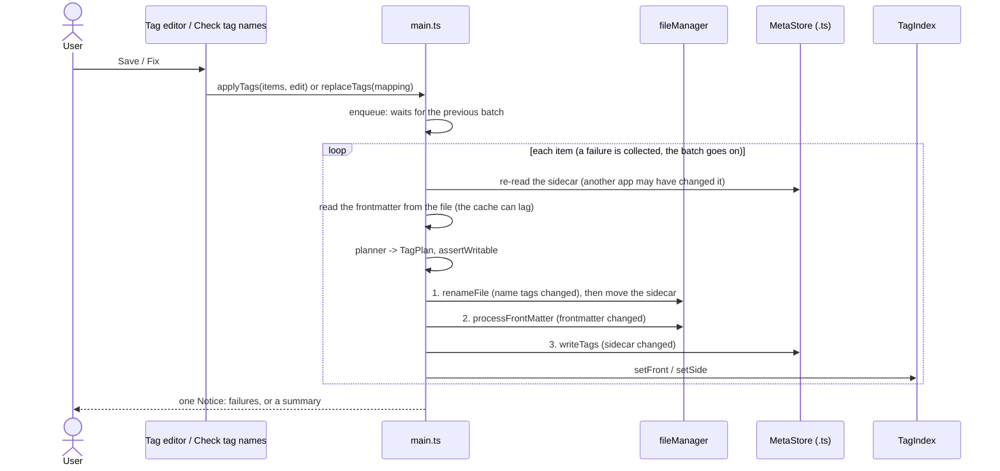
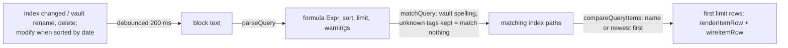
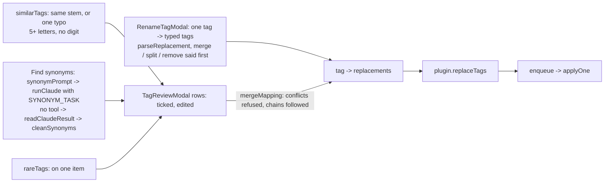
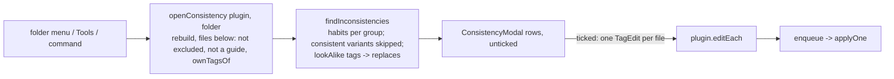
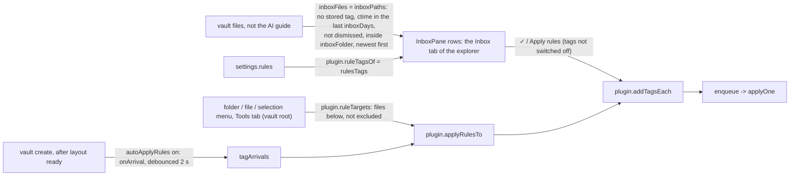
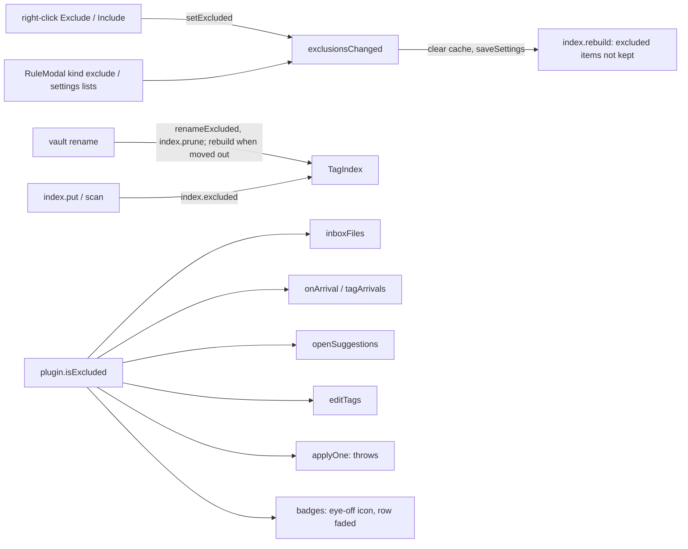
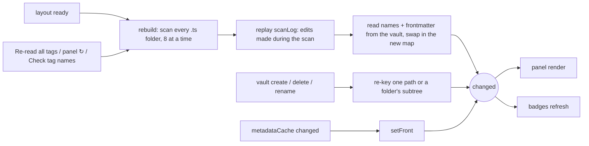
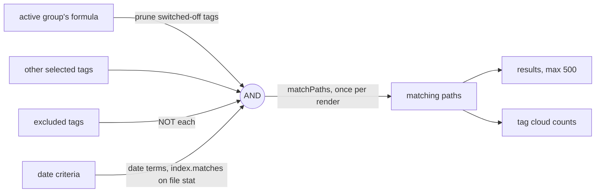
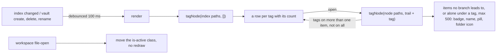

# TagEverything architecture

How the plugin is built, for whoever maintains it. What it does for users: [user-guide.md](user-guide.md). The
storage format: [format.md](format.md). The rules that must never break (invariants) and how to test:
[../CLAUDE.md](../CLAUDE.md).

## Layers

Pure modules hold every decision (parse, plan, validate, combine) and are unit-tested under `node --test`. The
Obsidian modules only read state, call the pure functions and apply the result.

```mermaid
flowchart TB
  subgraph wiring ["Obsidian wiring (smoke-tested in a real Obsidian)"]
    main[main.ts<br/>plugin: menus, commands, write path]
    view[view.ts<br/>TagEverything panel]
    pgroups[panel-groups.ts<br/>panel: Groups section]
    explorer[explorer.ts<br/>TagEverything explorer]
    items[items.ts<br/>row actions]
    dialogs[dialogs.ts<br/>name + group dialogs]
    modal[modal.ts<br/>tag editor]
    fixm[fix-modal.ts<br/>Check tag names]
    sugm[suggest-modal.ts<br/>Claude Code suggestions]
    qblock[query-block.ts<br/>query blocks in notes]
    curator[curator.ts<br/>rename, merge, review]
    consm[consistency-modal.ts<br/>Check tag consistency]
    inboxv[inbox-pane.ts<br/>explorer: Inbox tab]
    tools[tools-pane.ts<br/>panel: Tools tab]
    rulem[rule-modal.ts<br/>auto-tag / exclusion rule]
    runner[claude-runner.ts<br/>Claude Code in the app]
    menu[menu.ts<br/>TagEverything submenu]
    settings[settings.ts<br/>settings tab]
    badges[badges.ts<br/>explorer badges]
    index[index.ts<br/>TagIndex]
    store[store.ts<br/>MetaStore: .ts I/O]
  end
  subgraph pure ["Pure logic (no obsidian import, unit-tested)"]
    format[format.ts<br/>storage format, planning]
    naming[naming.ts<br/>naming rule, fixes]
    formula[formula.ts<br/>AND / OR / NOT]
    groups[groups.ts]
    tabs[tabs.ts]
    config[config.ts<br/>settings data]
    cloud[cloud.ts]
    colors[colors.ts]
    messages[messages.ts]
    ui[ui.ts<br/>DOM helpers, matchTags,<br/>count range boxes]
    guide[guide.ts<br/>AI assistant guide]
    suggest[suggest.ts<br/>prompt, answer]
    claude[claude.ts<br/>runs a program]
    explore[explore.ts<br/>tag levels, row order]
    query[query.ts<br/>query block text, matches]
    taxonomy[taxonomy.ts<br/>look-alikes, synonyms, merge map]
    consistency[consistency.ts<br/>folder habits, exceptions]
    inbox[inbox.ts<br/>rules, inbox list]
    dates[dates.ts<br/>created / modified criteria]
    exclude[exclude.ts<br/>excluded paths, exclusion rules]
  end
  main --> modal & view & explorer & fixm & sugm & badges & index & store & settings & guide & claude & menu
  main --> qblock & curator & inbox & exclude & runner & consistency & consm
  consistency --> taxonomy
  view --> tools
  menu --> rulem
  tools --> curator & rulem
  runner --> claude & suggest
  exclude --> inbox
  qblock --> query & items
  curator --> taxonomy & suggest
  inboxv --> inbox & items & rulem
  settings --> rulem --> inbox & exclude
  query --> formula & explore
  taxonomy --> naming & suggest
  sugm --> suggest
  guide --> naming
  suggest --> naming & guide
  view --> dialogs & groups & tabs & formula & items
  explorer --> explore & items & inboxv
  modal & fixm & main --> naming
  index & store & main & naming & groups & tabs --> format
  groups --> formula
  settings --> config --> groups & tabs
```



## Where data lives

| Data | Where | Read / written by |
|---|---|---|
| Name tags | the file name, `report[a b].pdf` | `format.ts` (`parseNameTags`, `setNameTags`), renamed with `fileManager.renameFile` |
| Note tags | the note's frontmatter `tags` | `processFrontMatter` + `setFrontmatterTags`; followed live through `metadataCache` |
| Sidecar tags | `<folder>/.ts/<file>.json`, folder tags in `.ts/tsm.json` | `store.ts` through `vault.adapter` (dot-folders are invisible to the Vault API) |
| Settings, tag groups, bookmark tabs, exclusions (`excluded`, `excludeRules`) | `.obsidian/plugins/tag-everything/data.json` | `config.ts` (`normalizeSettings` repairs anything), saved with `saveData` |
| Panel state (search with its date criteria, filter, tab) | Obsidian's `workspace.json` | `view.ts` `getState` / `setState` |
| Explorer state (open tags) | Obsidian's `workspace.json` | `explorer.ts` `getState` / `setState` |
| Every item's tags, in memory | `TagIndex` | rebuilt from the three tag places, kept in sync by events |

## Writing tags: one path for every change

The tag editor (`applyTags`) and the vault fix (`replaceTags`) share one queued write path. Only the *planner*
differs: `planTags(mergeEdit(…))` for an edit, `replacePlan` for a fix.



The order rename → frontmatter → sidecar is what makes a failure part-way safe: tags only move *out of* the sidecar,
so at worst a tag is left in two places, never in none.

## Tag suggestions by Claude Code

Claude Code runs as a separate program, read-only; the plugin writes what the user keeps, through the write path
above (`addTagsEach`: one `Planner` adding each item's own tags).

```mermaid
sequenceDiagram
  actor U as User
  participant M as suggest-modal.ts
  participant P as main.ts
  participant C as claude -p (child process)
  U->>P: Suggest tags with Claude Code (folder, file or selection)
  P->>M: items (folder + files under it, max 50) and the working folder
  M->>M: suggestPrompt: items + their tags, vault tags (dictionary), naming rule
  M->>P: runClaude(folder, prompt, abort signal)
  P->>C: spawn, no shell, cwd = folder, prompt on stdin; tools Read, Glob, Grep only; --safe-mode, --json-schema
  C-->>P: JSON result (structured_output, cost, time)
  P-->>M: stdout
  M->>M: parseClaudeOutput, cleanSuggestions (rule, no tag the item has, max 5)
  U->>M: switch tags off, Add N tags
  M->>P: addTagsEach(item -> tags) -> enqueue -> applyOne
```

`--safe-mode --strict-mcp-config --system-prompt` keep the user's Claude Code setup (MCP servers, plugins, skills,
`CLAUDE.md`) out: measured on 2026-11-21, a two-note run cost $1.25 with it and $0.04 without. Closing the dialog
aborts the signal, which kills the process; a run is stopped after 10 minutes.

## Query blocks

`main.ts` registers a Markdown code block processor for the language `tag-everything`; each block becomes a
`TagQueryBlock` (a `MarkdownRenderChild`, so Obsidian unloads it with the note's rendering). Obsidian re-renders a
block when its text changes; the child itself re-renders when the vault changes.



Unlike the panel (`matchPaths` prunes tags no item carries, as if switched off), a saved query keeps them: `a AND
gone` finds nothing, and the block names `gone`.

## Rename, merge, review

Every change goes through `replaceTags(mapping)`, the vault-wide engine of *Check tag names* (see *Writing tags*):
each mapped tag is rewritten where it is (`replacePlan`), tag groups, bookmark tabs and the panel's search follow.



Claude Code gets `--tools ""` for synonyms (it answers from the tag list in the prompt), so invariant 7 holds with no
read access at all. Checked for real on 2026-11-21 (haiku, 8 tags: 3 s, $0.001).

**Tag consistency** finds the exceptions to a folder's habits, locally. A group = the files directly in a folder, and
its files of one extension; a habit = a tag on at least `MIN_CARRIERS` (3) files and `HABIT_SHARE` (3/4) of the group.



`editEach` is `addTagsEach` with removals: an item whose added tag breaks the naming rule loses its whole edit, so a
misspelled tag is never removed without its replacement.

## Inbox and auto-tag rules



A rule matches when every condition it has holds: the path is in its folder (`inFolder`: any depth, case and accents
ignored, shared with the inbox's `inboxFolder`), the name without its tags and extension contains one of its words, the extension is one of its list. A rule
without a condition matches nothing (`normalizeRules` drops it from `data.json`). Rules are edited in `RuleModal`
(from the inbox, a row, or the settings list, whose `addItem` / `onDelete` are Obsidian's declarative list).

## Exclusions

An item is excluded by a path in `settings.excluded` (itself or a folder above it) or by an exclusion rule
(`exclude.ts` `exclusionOf`: the auto-tag conditions without tags; a folder only through a folder-only rule).
`plugin.exclusion(path, isFolder)` caches the answer per path until the exclusions change. Being excluded means not
being in the index, so everything that reads the index (panel, explorer, query blocks, counts, *Check tag names*,
reviews, the guide) leaves it out with no code of its own; the rest checks `plugin.isExcluded` / `taggable`.



Including an item again needs its tags read back (a sidecar too), so any change of the exclusions rebuilds the index;
a rename only prunes, unless the item left an exclusion.

## The index

`TagIndex` maps each tagged path to its name, frontmatter and sidecar tags, plus the merged list and a set for O(1)
lookups. `counts()` and `ranked()` are cached until the next change. It fires `"changed"` (debounced) only when a tag
really changed; the panel and the badges redraw on it.



A scan is asynchronous: while it runs, sidecar edits, renames and deletions are both applied live and logged in
`scanLog`, then replayed on the scan's result before the swap, so nothing that happens during a scan is lost.

## The panel's search

The search is a formula (`formula.ts` `Expr`), built from the panel state by `searchExpr()`, then evaluated on every
tagged item. Tags no item carries are pruned first, as if switched off. The date criteria (`dates`, src/dates.ts:
created / modified, recent or old) are ANDed as date terms (`created:30d`, the formula's own syntax, also usable in
group formulas, the explorer's box and query blocks); `index.matches` answers them from the file's `stat` (folders
have no date), so a date alone is a search.



Every change to the search goes through `setMode(tag, …)`, `selectGroup(id)`, `setDates(dates)` or `resetSearch()`
(tags only: a new tag search keeps the dates; *Clear* drops both), then `stateChanged()` (redraw + save the panel
state). The tag lists (All, Narrow) leave out the tags that are only extensions unless `panelExtensionTags` is on
(`tagShown()`: stored tags, from `counts(undefined, true)`, plus the search's).

## The explorer

`explorer.ts` draws a tree of tags from the index (stored tags only: `ownTagsOf`), not from the core explorer: the vault
loads every file whatever *Detect all file extensions* says (only the core explorer hides the unsupported ones), so
every tagged file shows. Each open node is `explore.ts` `tagNode(parent's paths, trail)`; rows use Obsidian's own tree
classes (`tree-item`, `tree-item-self`, `collapse-icon`, `tree-item-children`, `tree-item-flair`). The formula box
holds `chips` (an `Expr` drawn by `ui.ts` `renderExpr`, as the panel's group formulas) then the text being typed;
`joinFormula` makes them one formula, `treeSearch` reads it (the panel's syntax, unknown tags pruned, last valid formula
or the chips kept on a syntax error), and it filters the index paths before the root node, so the whole tree holds
only the matching items. A picked suggestion or Enter turns the text into chips (`commit`, when the whole formula
parses); a chip's × or Backspace `prune`s its tag. Under the box, the tag count range (shared with the panel's All tab, see
`view.ts`) keeps the root to the tags used that many times, unless a formula filters the tree; an open tag stays.



## Module reference

| File | Role |
|---|---|
| `src/format.ts` | **Pure** storage format: `extensionTag(name)` (lower-cased last extension, 1-10 letters / digits, else null; derived, never written), `parseNameTags`, `setNameTags`, `normalizeTag` (+ `nested` for frontmatter; a `/` outside it gets a "nested tags only go in a note's frontmatter" message), `parseTagInput`, `splitTagInput`, `assertWritable`, `frontmatterTags` / `setFrontmatterTags`, sidecar parse / merge / serialize, `.ts` paths, `planTags` (targets `filename` \| `sidecar` \| `frontmatter`), `mergeEdit`. Tag-list helpers: `dedupe`, `sameTags`, `TagMapping` + `mapTagList` (a vault fix's tag → replacements map). |
| `src/naming.ts` | **Pure** naming rule: a tag is one lower-case word of letters / digits / marks (`\p{L}\p{N}\p{M}`), not a liaison word. `DEFAULT_STOP_WORDS` (French + English articles, prepositions, conjunctions, determiners, elided letters; deliberately not `it`, `us`, `pas`, `est`, `y`), `makeRule(stopWordsText)`, `ruleProblem` / `followsRule` / `ruleMessage`, `suggestFix` (lower-case, split on any non-word character, `/` included, so a nested tag breaks the rule and splits: `proj/alpha` → `proj`, `alpha`; liaison words dropped, an all-single-letter compound joined: `R&D` → `rd`; `[]` = drop the tag; always a fix), `parseTypedTags` (editor input: lower-cases, `/` read as `-` so it never hits the file-name error, a compound's fix goes in `rest`, a liaison word is left out, a hard error keeps the raw word; no rule → `parseTagInput`), `auditTags(counts)`, `replacePlan(state, mapping)` (each mapped tag rewritten **in the place it was**; a replacement the item already carries unmapped is not added again; one coming from two places lands in the first), `parseReplacement`. |
| `src/formula.ts` | **Pure** tag formulas: `Expr` tree (`tag` / `date` / `and` / `or` / `not`; `DateExpr` `{ field, range }` from src/dates.ts, written `created:30d` / `modified:>1y`, units d w m y, also `créé:` / `modifié:`; a word starting with a date field and a colon that is not one is a syntax error; a tag spelled like one is quoted), `dateExpr`, `dateExprs(filters)`, `dateTermText`, `isDateWord` (query option lines), `hasDateTerms`, `topDates` / `withTopDates` (the date terms ANDed at the top: the explorer's calendar menu), `evaluate(e, has, dated)` (`dated(field, range)` asked only for date terms; default: no match), `parseFormula` (AND OR NOT, ET OU NON, & \| !, `!tag`, parentheses, side by side = AND, quotes; readable errors), `tryParseFormula`, `formatFormula` (canonical, minimal parentheses, round-trips), `evaluate`, `requiredTags` (tags every match carries), `prune(e, keep, keepDate?)` (drop switched-off tags, NOT with them; date terms kept unless `keepDate` rejects them; null if nothing left), `resolveTags` (case-insensitive to the vault's spelling), `formulaTags`, `andOf` / `orOf` / `notExpr`, `toggleNot`, `replaceTagsInExpr(e, mapping)` (a tag → AND of its replacements; mapped to nothing → pruned). |
| `src/groups.ts` | **Pure** tag groups `{ id, name, tags, collapsed, formula? }`, immutable: `addGroup` (ids `g<n>` from `nextId`), `renameGroup`, `deleteGroup`, `addTagsToGroup` (with a formula: `AND tag`), `removeTagFromGroup` (prunes it from the formula), `removeDateFromGroup(groups, id, term)` (same field and range), `setCollapsed`, `moveGroup`, `setFormula` (what the group dialog shows: tags := the formula's; a plain AND of distinct tags is stored as tags without formula; null empties the group), `toggleTagNot` (a group without formula gets one; an unparsable one is left alone), `groupExpr` (formula, else AND of the tags), `groupFormula` (the parsed formula, or null), `formulaError`, `replaceTagsInGroups(groups, mapping)`, `normalizeGroups` (repairs whatever `data.json` holds, never throws). Shared with tabs: `cleanName`, `cleanTagList`, `nextId(items, prefix)`. An unparsable stored formula is kept (error shown, search falls back to AND); a group may name a tag no item carries (shown faded). |
| `src/tabs.ts` | **Pure** bookmark tabs `{ id, name, tags, groups }` (`groups` = group ids), immutable: `addTab` (ids `t<n>`), `renameTab`, `deleteTab`, `setBookmark(tabs, id, "tags" \| "groups", value, on)` (adds once, at the end), `forgetGroup`, `replaceTagsInTabs`, `normalizeTabs(raw, groupIds)` (drops ids of groups that are gone). |
| `src/config.ts` | **Pure** settings data: `TagEverythingSettings` (incl. `extensionTags`, on by default, and `panelExtensionTags`, the panel's toggle, off), `DEFAULT_SETTINGS`, `normalizeSettings(raw)` (wrong types / out-of-range values → defaults, unknown keys kept, groups, tabs and auto-tag rules repaired, `inboxDays` 1-365; never throws). Inbox: `rules`, `autoApplyRules` (off), `inboxDays` (30), `inboxFolder` (`""` = whole vault, `cleanFolder`ed), `inboxDismissed`. Exclusions: `excluded` (paths), `excludeRules` (src/exclude.ts). |
| `src/cloud.ts` | **Pure** `cloudWeight` / `cloudWeights`: 0..1 per tag, log scale, 5 levels, relative to the tags shown. `narrowingTags`: the tags that can still narrow a search (on some of its items, not all, not in it), for the Selection tab. `styles.css` maps it to `--font-ui-small × (1 + 0.4 × weight)` (the tag tabs' cloud; the Selection tab's *Narrow* chips are one size). All's count range: `CountRange`, `inCountRange` (bounds included, max 0 = no limit, a max under the min read the other way round), `rangeText` (`10–100`, `10+`), `countSteps` (a slider's stops: the distinct counts) and `stepOf` (a bound's stop; the max slider's extra end stop = no limit). |
| `src/colors.ts` | **Pure** `autoColor(tag)`: one of 8 theme colours (`var(--color-*)`), FNV-1a hash of the tag's root, lower-cased (nested tags share their root colour). |
| `src/messages.ts` | **Pure** notice texts: `PLUGIN_NAME` (menu, notices, panel and dialog titles), `plural`, `failureMessage` (first 5, then "…and N more"), `progressMessage`, `claudeError(err, doing)` (not found → where to set the program; else Claude Code's message). |
| `src/guide.ts` | **Pure** AI assistant guide: `claudeGuide(input)` builds the `CLAUDE.md` Markdown from the settings that decide where tags go (storage, frontmatter, rule, liaison words) and the tag counts of the folder's subtree and of the vault (`tagList`: most used first, 80 shown, the rest counted); `guidePath(folder)`, `hasGuide(names)` (case-insensitive). Written by `main.ts` `writeGuide(folder)` (folder menu, root command) with `vault.create`, skipped when a guide exists: never overwritten. |
| `src/suggest.ts` | **Pure** Claude Code suggestions: `suggestPrompt(input)` (working folder, items with their stored tags, the vault's tags most used first through `guide.ts` `tagList`, the naming rule or the format's limits: `ruleText`, also used by the synonym prompt), `ClaudeTask` (system prompt, schema, tools) and `SUGGEST_TASK` (Read, Glob, Grep), `claudeArgs(model, task)` (print mode, JSON output, `--tools` the task's tools or `""` for none, `--allowedTools` only with tools, `dontAsk`, `--safe-mode`, `--strict-mcp-config`, the task's system prompt and schema), `claudeCommands(setting, home, windows)` (the setting, else `claude` then `~/.local/bin/claude.exe`), `readClaudeResult` (`structured_output`, else the JSON in `result`; readable errors, cost, time), `parseClaudeOutput` (the suggestion items), `cleanSuggestions(answer, input, rule)` (asked items only, in order; normalized, rule fix, the vault's spelling without the rule, no tag the item has nor its extension, `MAX_NEW_TAGS`; `fresh` = not in the vault yet), `relativeTo`, `commonFolder`, `MAX_SUGGEST_ITEMS`. |
| `src/claude.ts` | Runs a program, no `obsidian` import (the `spawn` is passed in): `runProcess(spawn, command, args, { cwd, input, timeoutMs, signal })` (no shell; stdin written then closed; stdout on exit 0, the end of stderr otherwise; timeout and abort kill it), `NotFoundError` (ENOENT), `runFirstFound` (next command while not found). Unit-tested with real `node` processes. |
| `src/ui.ts` | DOM helpers shared by the panel, dialogs, editor, badges and explorer (no `obsidian` import): `clickable` (Enter / Space like a click), `isNode` (pop-out safe), `paintTag` (sets `--tag-everything-color`), `matchTags` (autocomplete ranking, unit-tested), `renderTagSuggestion`, `onEnter`, `renderExpr(parent, e, chip, date = dateChip)` (a formula as chips between AND / OR / NOT and the parentheses it needs: panel groups and search, explorer box, query blocks; date terms through `date`, default `dateChip`: `.tag-everything-date-chip` with the criterion in words), `TAG_MIME` / `GROUP_MIME` and `dropZone` (tags and groups dragged within the panel), `countRangeControl` (the tag count range as "used [min]–[max] See all": a readable number typed applies at once through `change(r, false)`, Enter / Escape / leaving the box commits through `change(r, true)`, an unreadable one goes back; `update(r)` shows the stored range except in the box being typed in). |
| `src/index.ts` | `TagIndex` (see *The index*): `get` (name, front, side, `ext`), `tagsOf` (extension tag first, then the stored ones; shared read-only array), `ownTagsOf` (stored tags only: what an edit can change), `setExtensionTags(on)` (from `saveSettings`), `hasTag`, `dated(path, field, range, now)` (the file's `stat`; a folder: false), `matches(expr, path, now)` (a formula on one item, tags and dates: the panel, the explorer), `colorOf` (sidecar colour) / `colorFor` (sidecar, else `autoColor` when `autoColors` is on), `paths`, `size`, `counts(paths?, own?)` (`own`: no extension tags; *Check tag names* and the guide), `ranked()`, `setSide`, `setFront`, `onCreate` / `onDelete` / `onRename`, `rebuild()`, `ready` (false until the first scan). `excluded(path, isFolder)` (set by the plugin): such an item is never kept (`put`, the scan); `prune()` drops those excluded since. `cachedFrontTags(app, file)` reads a note's tags from the metadata cache. |
| `src/store.ts` | `MetaStore`: `metaPathOf(item)`, read / write sidecar tags (refuses to overwrite unparsable JSON; no file created for an empty list), `moveFileMeta` (sidecar + thumbnail; never overwrites, handles case-only renames). |
| `src/main.ts` | Plugin wiring: views (panel, explorer) and the `tag-everything` code block processor with their hover-link sources; menus (`file-menu`, `files-menu`: entries from `menu.ts`), commands, ribbon (panel, explorer), `openView` / `openExplorer` (one `revealView(type, side)`), rename hook (`ownRenames` keeps its own renames away from it), `rule` (cached `NamingRule`, null when the rule is off), `reindex()`, `checkTagNames()`, `renameTag(tag)`, `reviewTags()` (rebuild first), `checkConsistency(folder = root)` (→ `consistency-modal.ts` `openConsistency`), `insertQuery(editor)` (selection, else the explorer's `currentFormula()`), `openInbox()` (the explorer on its Inbox tab) / `openTools()` (the panel on its Tools page), `focusInbox(folder)`, `closeOldInbox()` (at layout ready: closes a 0.27 inbox sidebar leaf left in `workspace.json`), `ruleTagsOf(file)`, `ruleTargets(items)` (files below the items the rules would tag, not excluded, not a guide), `applyRulesTo(items)` (→ `addTagsEach`, one notice), auto-tag on arrival (`onArrival` → `tagArrivalsSoon`, debounced 2 s → `tagArrivals` → `applyRulesTo` when a rule matches), `writeGuide(folder)` (AI assistant guide, src/guide.ts), `suggestTags(selection)` (→ `suggest-modal.ts` `openSuggestions`), `runClaude(folder, prompt, signal, task?)` (→ `claude-runner.ts` `runClaudeIn`; a public field so the smoke test can fake it), exclusions (*Exclusions* above: `exclusion(path, isFolder)` cached, `isExcluded`, `taggable` (not the root, not excluded), `setExcluded(paths, on)`, `exclusionsChanged()`, the rename hook's `renameExcluded`), `addTagsEach(map)` (each item its own added tags, rule-breaking ones left out; through `editEach(map)`: each item its own `TagEdit`, the whole edit dropped when an added tag breaks the rule), and the write path: `applyTags` (refuses the whole edit when an **added** tag breaks the rule; tags already on an item are never checked) and `replaceTags` (finds the items through the index, snapshots each open panel's search, runs the batch, then maps `settings.groups` / `settings.tabs` and gives each panel its search back mapped), both through `enqueue` → `applyNow` (progress notice past 5 items, one failure notice) → `applyOne` (refuses an item no longer in the vault or excluded, re-reads sidecar and frontmatter, plans, `assertWritable`, rename → frontmatter → sidecar). |
| `src/modal.ts` | `TagEditorModal`: chips; partial chips (`3/5`) in multi-edit; filename preview; returns a `TagEdit` diff (`added`, `removed`), not a full list, so multi-edit keeps each item's other tags. Typed text goes through `parseTypedTags`: invalid words stay in the box with their error, a compound breaking the rule is replaced in the box by its fix, a liaison word is left out; `commitInput` returns false while anything is left, so Save waits; a separator typed at the end commits. Suggestions (`matchTags`) hide tags breaking the rule; a picked one is checked with `normalizeTag` and `ruleMessage`. `describe(items)` names a batch in notices. |
| `src/claude-runner.ts` | `runClaudeIn(app, settings, folder, prompt, signal, task?)`: Node's `child_process` / `os` through Electron's `require`, cwd from `FileSystemAdapter.getBasePath()`, program and model from the settings, 10 min timeout, through `claude.ts` `runFirstFound`. |
| `src/suggest-modal.ts` | `openSuggestions(plugin, selection)`: the items (a folder alone: it and its files, untagged first, at most `MAX_SUGGEST_ITEMS`, excluded ones left out) and Claude Code's working folder, then the dialog. `TagSuggestModal`: builds the `SuggestInput` from the index and settings, calls `plugin.runClaude`, then one row per item (name, path, current tags, suggested chips `is-selected` to switch off, `is-new` for tags the vault lacks); *Add N tags* → `plugin.addTagsEach(chosen())`. Errors (not found, not JSON, Claude Code's own) replace the list; `onClose` aborts the run. `done` resolves once the answer or the error is shown (smoke test). |
| `src/fix-modal.ts` | `TagFixModal` (*Check tag names*): `auditTags` over `index.counts()`, one row per tag (checkbox, chip, ×count, problem, editable fix with `data-tag`, row error); rows without obvious fix start unchecked; typing a fix ticks it; *Fix N tags* is disabled while a checked fix breaks the rule. `fix()` → `plugin.replaceTags(mapping)`. Works with the rule off too (configured liaison words). |
| `src/query.ts` | **Pure** query blocks: `QUERY_LANGUAGE`, `parseQuery(source)` (option lines `sort:` / `limit:`, `//` comments, the other lines joined as the formula; bad options → `warnings`, the rest still works), `matchQuery(expr, paths, has, known, dated)` (vault spelling; unknown tags kept and named; `dated` answers date terms); a line `created:…` / `modified:…` is formula, not an option, `compareQueryItems(sort)` (explorer name order, or newest first). |
| `src/query-block.ts` | `TagQueryBlock` (`MarkdownRenderChild`, hover source `QUERY_HOVER_SOURCE`): head (formula chips through `renderExpr`, a click → `plugin.showTag`; count), warnings, rows (`renderItemRow` + `wireItemRow`), "…and N more"; re-renders on index / vault events (debounced). |
| `src/taxonomy.ts` | **Pure** tag review: `foldTag`, `editDistance` (with swaps), `similarTags(counts)` (union-find over same stem = folded, plural s / x dropped, `sure`; or one typo between 5+ letter digit-free words), `rareTags`, `mergeMapping(rows)` (into tags stay; conflicts and cycles refused; chains followed), `SYNONYM_TASK` (no tool), `synonymPrompt(counts, rule)`, `cleanSynonyms(answer, counts, rule)` (vault spelling, unknown dropped, `into` put to the rule or the most used, a tag in one group). `lookAlike(a, b)` (same stem or one typo; also used by `consistency.ts`). |
| `src/consistency.ts` | **Pure** tag consistency: `findInconsistencies(files)` (`{ path, tags }`, stored tags) → `Finding`s `{ path, folder, tag, carriers, size, ext, replaces }` by folder, path, tag. Groups: a folder's direct files, and its files of one extension when fewer than all; habits: `MIN_CARRIERS` and `HABIT_SHARE`, not on every file; a file without a habit is a finding unless it carries another tag shared by 2+ files of the group none of which has the habit (a variant) and no look-alike; `replaces` = its look-alikes of the habit that are not habits themselves; a folder-wide finding is not repeated by its extension group. |
| `src/consistency-modal.ts` | `openConsistency(plugin, folder)` (rebuild, the files below the folder, not excluded, not a guide, with `ownTagsOf`; then the dialog). `ConsistencyModal(app, plugin, folder, findings)`: a sticky header row per folder, one row per finding (`data-path`, `data-tag`; name, its tags, *N of the M files here carry*, → the tag, *instead of* the look-alikes; disabled when the tag breaks the naming rule), at most 500; nothing ticked; *Tick all*; *Fix N files* → `apply()` → `plugin.editEach` (one `TagEdit` per file). |
| `src/curator.ts` | `RenameTagModal` (`plan()`: rename / merge / split / remove said before; `apply()`), `TagPickerModal` (the command's fuzzy tag list), `TagReviewModal` (look-alike rows, *Find synonyms with Claude Code* → `synonyms` promise, rare tags in a `<details>`; `mapping()` validates rows then `mergeMapping`; `apply()`); all through `plugin.replaceTags`. |
| `src/inbox.ts` | **Pure** inbox and rules: `AutoTagRule` `{ id, folder, words, extensions, tags }`, `normalizeRules`, `hasCondition`, `ruleMatches`, `rulesTags(rules, path, has)`, `RuleConditions` (shared with exclusion rules), `describeConditions`, `describeRule`, `saveRule` / `deleteRule` (immutable, generic, ids `r<n>` or the prefix given), `inboxPaths(candidates, now, days, dismissed, folder, dates)` (a `created` criterion replaces the last `days`, a `modified` one is checked too; `mtime` defaults to `ctime`), `inFolder(path, folder)`, `ageText`, `wordList`, `cleanFolder`. |
| `src/dates.ts` | **Pure** date criteria (panel search, inbox): `DateField` (`created` = `stat.ctime`, `modified` = `stat.mtime`), `DateRange` `{ within, days }` (in the last / more than N days ago), `DateFilters` (at most one per field), `DATE_PRESETS`, `inRange`, `datesMatch(filters, times | null, now)` (null = a folder: no criterion met), `hasDates`, `sameRange`, `rangeText` / `criterionText` / `filtersText`, `normalizeDates` (saved panel state). |
| `src/inbox-pane.ts` | `inboxFiles(plugin, dates)`: the inbox's `TFile`s from the settings and the pane's date criteria (also the count on the Inbox tab). `InboxPane(plugin, host, changed)`: `dates` (the *Dates* button's `menu.ts` `dateMenu`; a change calls `changed`, the explorer's redraw, so the tab count follows; status says the criteria, rows the modification age while a `modified` one is set); the explorer's Inbox tab (`explorer.inbox`, `plugin.openInbox()`), drawn by the explorer's `render()` into its page element, so it follows index and vault changes: `render(el)`, `files()`, status naming the focus folder (and a missing one when nothing is listed), rows (`renderItemRow` + arrival age + rule chips to switch off + one ⋮ icon, `data-action="menu"`, opening `rowMenu(file)` under it: add the rule tags / edit / suggest / new rule / dismiss), *Apply rules to N files*, Claude Code on the newest 50, new rule, *Whole vault* while focused (`plugin.focusInbox("")`); `applyRules(files)`, `dismiss(file)`. |
| `src/tools-pane.ts` | `renderTools(el, plugin)`: the panel's Tools tab, the vault-wide actions as `Setting` rows (buttons with `data-action`): re-read (`reindex`), *Apply auto-tag rules* (count from `ruleTargets([root])`, `applyRulesTo`, *New rule…*), *Check and fix tag names*, *Review tags*, *Check tag consistency* (`checkConsistency()`), *Rename or merge a tag* (`TagPickerModal`). |
| `src/rule-modal.ts` | `RuleModal(app, plugin, draft, onSaved, kind)`: folder (`FolderSuggest`), words, extensions, tags (`FormulaTagSuggest`, `parseReplacement`); live preview (matches, untagged); `save()` → `settings.rules` (`saveRule`) + `saveSettings`; *Delete rule* when editing. `kind` `"exclude"`: no tags (field hidden), preview = files excluded, saved to `settings.excludeRules` (ids `x<n>`) + `plugin.exclusionsChanged()`. |
| `src/exclude.ts` | **Pure** exclusions: `ExcludeRule`, `Exclusion` (`by` path or rule), `exclusionOf(path, isFolder, paths, rules)` (a path first, exact, the item or a folder above; then the first rule), `excludeRuleMatches` (a file as `ruleMatches`; a folder only by a folder-only rule, itself and below), `setExcluded` (a folder replaces the paths under it), `renameExcluded`, `normalizeExcludedPaths`, `normalizeExcludeRules`. |
| `src/menu.ts` | `addPluginMenu(menu, entries)`: the plugin's entries in one *TagEverything* submenu (internal `setSubmenu`), flat and prefixed if it is missing. `fileMenuEntries(plugin, file, fromPlugin)` / `filesMenuEntries(plugin, files)`: the targeted actions (*Show in the file explorer* from the plugin's views, *Edit tags* on every item but the vault root, Claude Code suggestions, *Apply auto-tag rules (N files)* only when `ruleTargets` finds some, folders: *Inbox of this folder*, *Check tag consistency* and the guide, *Exclude* / *Include … again*; an excluded item gets only `includeEntry`). |
| `src/panel-groups.ts` | `PanelGroups`: the panel's tag groups, through a `GroupsHost` the view builds (its search state, chips, bookmark menu items, `save`, `matchPaths`): `render(el)` (the Groups section of a tag tab) and `renderGroup(el, group, inSelection)` (one card: fold, formula icon, labelled search button, ⋯ menu, chips with their vault count, ⊘ NOT and × hover buttons, the group searching's switched-off tags dashed (`is-off`), drop zones to add tags and reorder; the Selection tab draws the group searching with it too, `inSelection`: no fold, no search button, no *Show in Selection* in its menu), the group menu, `newGroup(expr, run)` and `editGroup(group)` (`dialogs.ts` `GroupModal`), `createGroup`, `setGroupFormula`, `addToGroup`; formulas saved through `parseFormula` → `withFormula` (on the active group, its new tags join the search: `host.addToSearch`) → `groups.ts` `setFormula`. |
| `src/view.ts` | `TagEverythingView`: tag cloud, search bar, bookmark tabs, results; the Groups section is `panel-groups.ts`. One tab strip, one pane at a time: a tag tab (All or a bookmark tab: groups and every tag with its vault count whatever the search, the search's tags marked; full height) or a `page` (`PanelPage`, at the end of the strip in `.tag-everything-tabs-end`): **Selection** (the search bar in a card, *Narrow*: the narrowing tags from `cloud.ts` `narrowingTags` counted in the matches, one size (`renderRefine`, `cloud(…, sized = false)`), *Results*: a section head in `statusEl`, then the results), shown only while `hasSearch()`; **Tools** (wrench, `tools-pane.ts`), drawn into `pageEl` (no Inbox page since 0.33: a saved `page: "inbox"` falls back to the tags). `render()` toggles the elements, `setMode` (adding a tag), `selectGroup`, `selectOnly` switch to Selection, `showPage(page)` to any page, `showTab` and typing in the filter back to the tags; vault create / delete / rename redraw it debounced (what the Tools rules would tag). State `selected`, `excluded`, `dates` (date criteria: the bar's calendar icon `datesEl` opens `menu.ts` `dateMenu` → `setDates`; drawn as `.tag-everything-date-chip`s in the search; `hasSearch()` counts them; `searchExpr()` ANDs them as date terms, so `matchPaths` (`index.matches`) applies them and *Formula…* keeps them; `selectGroup` drops them when the group has date terms of its own), `activeGroup`, `filter`, `tab`, `page`, `selection` (= `page === "selection"`, also read from a 0.27 state without `page`) (persisted; `render()` only prunes `selected` / `excluded` once `index.ready`). `searchExpr()` / `searchMatches()` / `matchPaths(expr)`; `setMode`, `toggle`, `selectGroup`, `selectOnly`, `resetSearch`, `stateChanged`. A group search shows `groupsPane.renderGroup(…, true)` at the top of Selection. The Selection tab's *Formula…* runs `groupsPane.newGroup(searchExpr(), true)` and *Edit group* `groupsPane.editGroup` (the Selection buttons are `.tag-everything-icon-button`: icon in a `.tag-everything-button-icon` flex box, centred on the label). Groups and tabs saved by `save({ groups?, tabs? })` straight to `data.json`. `renderExpr` draws a formula as chips between `.tag-everything-op` spans. Drag and drop: chips carry `ui.ts` `TAG_MIME`, group headers `GROUP_MIME` (`ui.ts` `dropZone`). Results: the extension tag as a chip in place of the file icon (`.tag-everything-result-ext`), the other tags below, at most `MAX_RESULTS` (500, shared with the explorer); rows drawn by `items.ts` `renderItemRow`, their actions from `wireItemRow`. A tag's right-click menu adds *Rename or merge tag…* for a stored tag. The tag count range (settings `tagRangeOn` / `tagRangeMin` / `tagRangeMax`; `countRangeOf(settings)`, `setCountRange(plugin, r, save)`, exported for the explorer too): the Tags heading, built once in `onOpen`, holds the count (`tagsCountEl`), the extension tags toggle (`extToggleEl`, setting `panelExtensionTags`, saved at once; `tagShown()` used by `renderTags` and `renderRefine`) and the `ui.ts` `countRangeControl` (both shown in All only); `renderTags` keeps the tags `inCountRange` (not in a bookmark tab, not while `filter` is typed, never dropping a tag of the search) and says *n of m*. A number typed only changes the settings and redraws the tags; committed, `saveSettings` triggers the index's `changed`, so the panel and the explorer redraw and their boxes `update` (not the one being typed in). Public for the smoke test: `setDates`, `showPage`, `createGroup` and `setGroupFormula` (to `panel-groups.ts`), `createTab`, `showTab`, `selectGroup`, `searchSnapshot`, `replaceTags`. |
| `src/items.ts` | What a file or folder row shows and does in the panel, the explorer, query blocks and the inbox: `revealInExplorer(app, item)` (the internal `revealInFolder`), `openItem(app, item, evt)` (non-notes in the system app through the internal `openWithDefaultApp`, Ctrl/Cmd = new tab, a folder revealed in the core explorer), `renderItemRow(parent, item, index, chip)` (extension chip or icon, name, folder, other tags; returns `{ row, body }`) and `wireItemRow(host, row, item, activate?)` (`RowHost` = app, hover-link source, hover parent, leaf; click / Enter = `activate`, default `openItem`; middle click; `file-menu` on right-click; `hover-link`; drag into a note through the internal `dragManager`). |
| `src/explore.ts` | **Pure** explorer logic: `tagNode(paths, tagsOf, trail)` (`paths` carrying every tag of the trail; the other tags they carry with per-item counts by name = the branches: all at the root, inside a tag only those on more than one item and not on all; `items` = those no branch leads to plus those alone under one of their tags; none at the root), `compareNames` (`Intl.Collator`, numeric, case / accents ignored), `compareItems` (folders first), `joinFormula(chips, typed)` (the box's chips in parentheses, then the text typed), `treeSearch(text, known, last)` (the formula box: `parsed` / `expr` applied / `problem`). |
| `src/explorer.ts` | `TagExplorerView` (`tag-everything-explorer`, left sidebar, `plugin.openExplorer()`, icon `EXPLORER_ICON` = `EXPLORER_ICON_SVG` registered with `addIcon`: Lucide's folder-tree with tags): two tabs (`ExplorerTab`, `renderTabs`: *Tags* and *Inbox* with the inbox count; `showTab(tab)`; `tab` persisted, a 0.28 state's `inbox` ignored): *Tags* shows the formula bar, status and tree, *Inbox* hides them and draws its own `InboxPane` (`inbox`) into `pageEl`; state `expanded` (open nodes as trails, persisted, keyed by `keyOf(trail)`), `activePath`, `chips` / `query` / `parsed` / `applied` (the formula box, not persisted; `FormulaTagSuggest` completes it and its `onPick` runs `commit`; `renderChips` (× = `removeChip`, Backspace on an empty box the last tag); Enter = `openRequired`: the trail of `requiredTags`, Escape clears). `renderNode` draws a node's tag rows (`data-tag`, `data-trail`, arrow, tag icon in its colour, count in the flair; open ones drawn inside `.tree-item-children` from the node's paths) then its items; `itemRow`: invisible arrow (alignment), extension badge or icon, name (basename after a badge), flair: `plugin.badges.addPill` (tag count, hover list) and the folder icon (tooltip = real folder, click = `revealInExplorer`). `file-open` → `highlight` (class only). Right-click a tag row: *Rename or merge tag…* (`plugin.renameTag`). The tag count range (`ui.ts` `countRangeControl` in `.tag-everything-explorer-range`, values from `view.ts` `countRangeOf`, changes through `setCountRange`): `renderNode`'s `keep` drops root tags out of range, unless a formula is applied or the tag is open; the status says *n of m tags*. Redraws debounced on index and vault events, scroll kept. `currentFormula()` (the applied formula as text, for *Insert a tag query block*). Public for the smoke test: `toggle(trail)`, `showTab`, `inbox`. |
| `src/dialogs.ts` | `NameModal` (tab name) and `GroupModal` (a group's name and formula in one dialog, for creating and editing; operator buttons `AND` `OR` `NOT` `(` `)` inserted at the caret, and *Date* (`dateMenu` → `dateTermText`); + `FormulaTagSuggest`, also used by the explorer's box, the rename and rule dialogs: completes the word before the caret from live `tags()` / `count()`, then `onPick?.()`; live preview: canonical formula and item count, or the error), `FolderSuggest` (vault folders containing the text). `dateMenu(filters, change)`: the date criteria menu (panel bar, inbox, explorer bar, group dialog: a label per field, *Any date*, the presets checked); here rather than in menu.ts, which imports the rule dialog, itself importing this file. Shared footer `addSubmitButtons`: Cancel / Save, Enter submits, an error from `done` keeps the dialog open. |
| `src/settings.ts` | Declarative settings tab (`getSettingDefinitions()`, Obsidian 1.13+, rows in Obsidian's settings search): storage, frontmatter, naming rule + liaison words (disabled while the rule is off), lower-case (disabled while the rule is on), renames, colours; group *File explorer* (badges; a hint row visible only when *Detect all file extensions* is off); group *Inbox* (open it, `inboxDays` number, `autoApplyRules` toggle, *Show dismissed files again* visible when some are); the declarative **list** *Auto-tag rules* (a row per rule → `RuleModal`, `addItem`, `onDelete`; `update()` redraws after a change); the lists *Excluded from the tag engine* (paths; the bin → `plugin.setExcluded(…, false)`) and *Exclusion rules* (`RuleModal` kind `"exclude"`); group *Tag maintenance*: one *Tag tools* row opening the panel's Tools tab (`plugin.openTools()`; settings hold options, the actions are in the panel). `setControlValue` repairs the value through `normalizeSettings`, `refreshDomState()`, saves. `groups`, `tabs`, `rules`, `inboxDismissed`, `excluded` and `excludeRules` are never written by a control (`PANEL_KEYS`). `targetFor(file, settings)` = where an item's new tags go. |
| `src/badges.ts` | `ExplorerBadges`: chips in the core explorer through its internal `fileItems`: the extension tag prepended **before** the name (`.tag-everything-ext`; the row gets `.tag-everything-has-ext`, which hides Obsidian's `.nav-file-tag`), a round pill after it (`.tag-everything-count`) with the number of stored tags. `addPill(host, tags)` (also used by the explorer's rows): hovering (or clicking) the pill opens one `.tag-everything-badge-list` in the page body (`position: fixed`, so the explorer's scroll container does not clip it; flipped above near the window bottom), the tags one per line, clickable; it closes 200 ms after the mouse leaves both. An excluded item (`plugin.exclusion`, every explorer row checked, only while there are exclusions, even with the badges off) gets only an eye-off icon after its name (`.tag-everything-excluded`, tooltip: why) and a faded row (`.tag-everything-is-excluded`). `refresh()` is keyed: each row has a signature (extension, tags, colours, or the exclusion) and only changed rows are redrawn; rows no longer tagged or detached are cleaned. |
| `styles.css` | Theme variables only, every class prefixed `tag-everything-`. Chip colour: `--tag-everything-color`; cloud size: `--tag-everything-weight`. |
