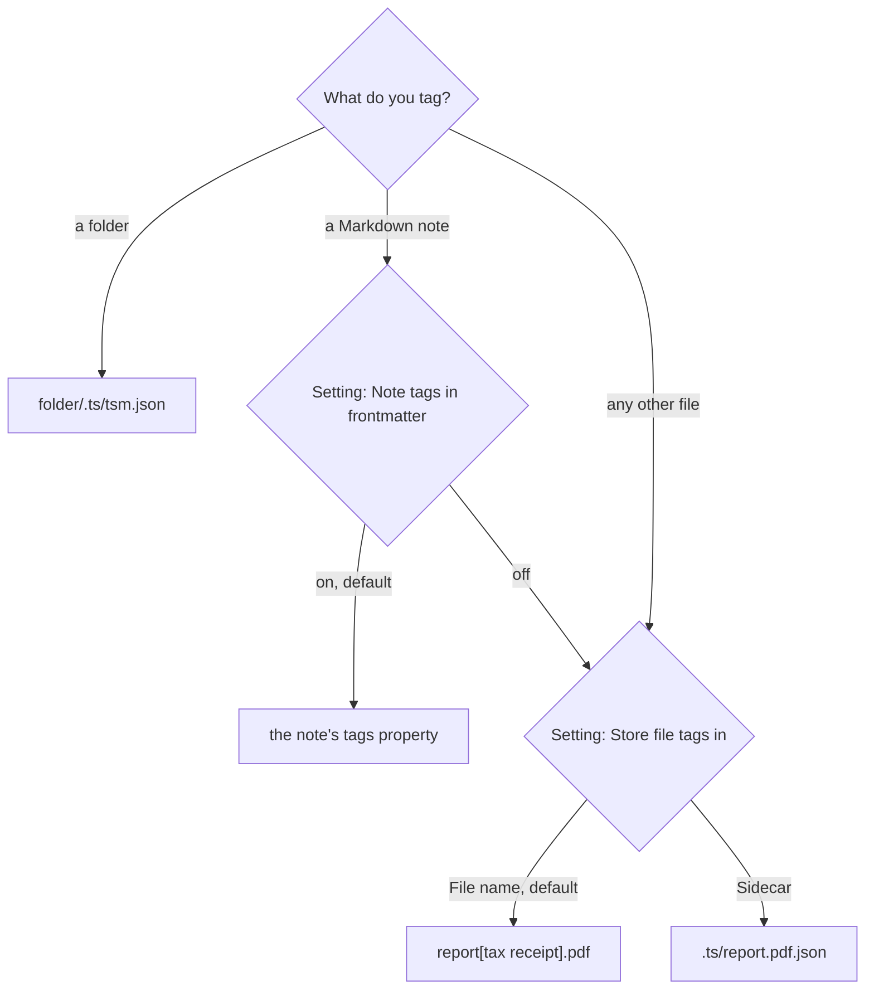
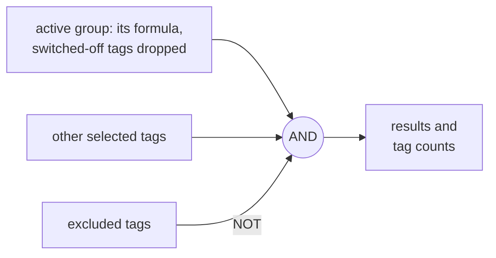
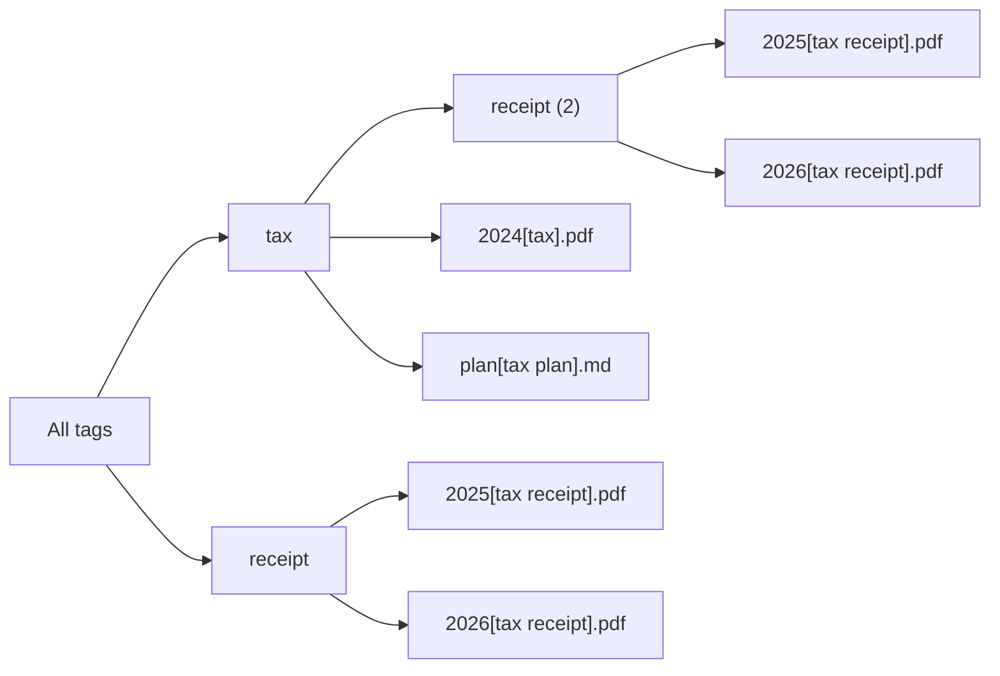

# TagEverything user guide

Tag any file or folder of your vault (notes, PDFs, Office files, images, folders), then find them again by their
tags. This guide covers every feature; the short version is in the [README](../README.md). The exact storage format
is in [format.md](format.md).

## 1. Where your tags are stored

Tags stay in your files, never in a private database, so other tag-aware file managers (TagSpaces) see them too.

| Item | Where new tags go | Example |
|---|---|---|
| Markdown note, **Note tags in frontmatter** on (default) | The note's `tags` property, as Obsidian stores it. The note is not renamed. | `tags: [b27, proj/alpha]` |
| Other file, **File name** (default) | First `[...]` group of the name, space-separated | `B27_Board_v10[b27 inc].docx` |
| Other file, **Sidecar** | `<folder>/.ts/<file name>.json` → `tags` | `.ts/B27_Board_v10.docx.json` |
| Folder (always) | `<folder>/.ts/tsm.json` → `tags` | `B27/.ts/tsm.json` |

Tags are always **read from every place and merged**: a note's tags are the tags in its name, plus its frontmatter
tags, plus its sidecar tags. A note named `budget[b27 inc].md` with `tags: [q3]` shows `b27 inc q3`. When you edit it,
the name tags you keep stay in the name and new tags go to the frontmatter. Folder names are never read for tags.
**Extension tags** (setting *File extension as a tag*, on by default): every file also carries its extension,
lower-cased, as a tag (`pdf`, `docx`, `md`), shown first. It is read from the name and stored nowhere, so the tag
editor doesn't show it, *Check tag names* ignores it, and the AI assistant guide explains it instead of listing it.
A name with no plain extension (`README`, more than 10 characters, or not only letters and digits) has none.
Other fields of a sidecar or `tsm.json` (id, description, colours…) and other note properties are kept.

## 2. Tag files and folders

- **Right-click → TagEverything → Edit tags** on a file or folder; on a multi-selection, **TagEverything → Edit
  tags of N items**; or the command *Edit tags of the current file*.
- Type a tag and press **Enter**, space or comma. Suggestions come from every tag of the vault, most used first.
- With several items, a tag only some of them carry shows as `3/5`: leave it (those items keep it), click it to give
  it to all, or remove it from all.
- A word that can't be a tag (e.g. `a:b`) stays in the box with the reason, so you can fix it. With the naming rule
  off, a nested tag (`proj/alpha`) works for notes and is refused up front where it can't go (a file name); with the
  rule on, it is split like a compound (section 3).
- For a single file, the dialog previews the **new file name** before you save. Renames go through Obsidian, so
  **links in notes are updated**.
- Tagging more than 5 items shows its progress. If some fail, one notice lists why (the first 5, then how many more).
  Edits run one after the other: a second edit started before the first is written waits for it.

## 3. The tag naming rule

Setting *Tag naming rule*, on by default: a tag is **one lower-case plain word** (letters and digits, accents
allowed), never a liaison word (`de`, `la`, `the`, `of`…; the list is the setting *Liaison words*).

- Typed upper case is lower-cased.
- A compound is refused and its fix put in the box instead: `Tax-Receipt` → `tax receipt` (two tags); press **Enter**
  to accept. `/` splits too, so there are no nested tags: `proj/alpha` → `proj alpha`.
- A liaison word is left out.
- Tags of the vault that break the rule aren't offered as suggestions.

The rule only applies to **new** tags. Existing ones stay until you run *Check tag names*.

## 4. Check tag names (fix the whole vault)

Command *Check tag names (naming rule) and fix them*, or *Settings → Tag maintenance → Check and fix tag names*.

1. It re-reads every tag (also those edited outside Obsidian).
2. It lists every tag that breaks the rule: how many items carry it, why, and a suggested fix (`B27` → `b27`,
   `plan_de_charge` → `plan charge`, `proj/alpha` → `proj alpha`, `R&D` → `rd`, `de` → removed).
3. Edit a fix if you want (several tags: separate them with spaces; empty: the tag is removed), untick the ones to
   leave, then **Fix N tags**.
4. Each tag is rewritten **where it is**: in the file name (the file is renamed, links follow), the note's frontmatter
   or the sidecar. Tag groups (formulas included: `Tax-Receipt` becomes `tax AND receipt`), bookmark tabs and the
   panel's search follow.

Run it again to see what is left.

## 5. The TagEverything panel

Open it with the ribbon `tags` icon or the command *Open the tags panel*.

- Every tag with its count; frequently used tags are a little bigger (at most 1.4× the normal size).
- **Click tags** to list the files and folders carrying all of them (AND).
- **Right-click a tag → Exclude this tag (NOT)** to leave out the items carrying it (shown as `NOT tag`, struck
  through, at the top); right-click it again to search with it instead.
- **Filter tags**: type, then **Enter** selects the first match, **Escape** clears.
- **Results** work like the file explorer: click to open (Ctrl/Cmd-click or middle-click: new tab; non-note files open
  in their default app, folders are revealed), **Ctrl/Cmd + hover** for a page preview, **drag** one into a note to
  link it, right-click for the usual file menu. A file's extension tag stands in for its icon, before its name, and
  its other tags show below; folders (and files, with extension tags off) keep their icon.
- Everything works from the keyboard (Tab, then Enter or Space). The panel remembers its search, filter and tab
  across restarts.
- The ↻ button re-reads all tags (after editing them outside Obsidian).

## 6. Tag groups and formulas

Groups keep related tags together and double as saved searches.

- **+** creates a group from the current search (excluded tags become `NOT tag` in its formula), or drop a tag on
  **+**. **Drag** any tag onto a group to add it; a tag can be in several groups.
- Groups **fold** (chevron) and reorder by dragging one onto another. **⋯** or right-click: search, rename, edit the
  formula, add the selected tags, bookmark, delete (the tags stay on the files).
- Hover a tag of a group: **×** takes it out of the group, **⊘** excludes it from the group's search (`NOT tag`,
  struck through; click ↶ to include it again). Both are also in the tag's right-click menu.
- **A group is a search**: click its **Search** button (it shows how many items the group finds), its name, or
  *⋯ → Search with this group*. The button reads **Stop** while the search runs. The group's tags show at the top:
  click one to leave it out (dashed), click again to put it back; click other tags to narrow further. Click the group
  again, or **Clear**, to stop.
- **Formulas** (*⋯ → Combine with a formula*): any combination of the group's tags, e.g.
  `(b27 OR inc) AND (q3 OR 2026)`.
  - Operators `AND` / `OR` / `NOT`, also `ET` / `OU` / `NON` and `&` / `|` / `!`, and parentheses. Two tags side by
    side mean AND. `NOT` binds first, then `AND`, then `OR`.
  - Tag names complete as you type; the dialog shows the formula as it understood it and how many items it finds, or
    what is wrong.
  - A tag switched off during a group search drops out of its `OR` / `AND` as if it were not written, `NOT x`
    included. Dropping a tag on a group with a formula adds `AND tag`; its × removes it from the formula.
  - Empty the formula to go back to "all the tags". Tags match whatever the case; a tag in quotes may contain a
    parenthesis or be spelled like an operator (`"ou"`).
- Groups are saved in the plugin's settings (`.obsidian/plugins/tag-everything/data.json`), not in your files.

## 7. Bookmark tabs

Under the filter box: a tab **All** (every group and tag), then your own named tabs, e.g. *Work* and *Home*.

- **+** creates a tab (drop a tag or group on **+** to start the tab with it).
- Bookmark a tag or group by **dragging it onto a tab**, or right-click it → **Bookmark in the tab "…"** /
  **Bookmark in a new tab…**. **Remove from the tab "…"** takes it out (the tag stays on your files, the group stays
  in All).
- A tab shows only what is bookmarked in it. A group created with **+** while a tab is shown is bookmarked there.
- Right-click a tab to rename or delete it (deleting a tab deletes nothing else).
- The search is the same whatever the tab; the panel reopens on the tab you left. Tabs are saved with the groups.

## 8. Colours and explorer badges

- Each tag gets its own colour, picked from its name among the theme colours: always the same in the panel, the
  badges and the editor; nested tags share their parent's colour. A colour stored in a sidecar wins. With 8 colours,
  two tags can share one.
- **Badges**: after a name in the file explorer, a round pill with the **number** of its tags (`report 3`). Hover
  it (or click it) to see the tags, one per line, in their colours; clicking a tag there opens the panel on it.
- The **extension tag** shows **before** the name (`pdf scan[tax].pdf`), not counted in the pill; Obsidian's own
  grey extension label after the name is hidden on those rows. *Badges for: tags not in the name only* keeps it.

## 9. A guide for AI assistants (CLAUDE.md)

An AI coding assistant working in your vault (Claude Code reads `CLAUDE.md` from the folder it starts in and from
its parents) does not know how TagEverything stores tags. Give it a guide:

- **Right-click a folder → TagEverything → Write AI assistant guide**, or the command *Write AI assistant guide in the vault root*.
- It writes `CLAUDE.md` in that folder: where tags live with your current settings, how to read them, the naming rule
  and its liaison words, how to add a tag without breaking anything (sidecar moved along on a rename, links to fix,
  `.ts` files to keep), the tags used in that folder and the most used tags of the vault, so the assistant reuses them.
- A `CLAUDE.md` already there (any case) is **never overwritten**: it is skipped with a notice. To refresh a guide
  (new tags, changed settings), delete it and write it again.
- One guide at the vault root covers every folder; add one in a folder when you want the assistant to see the tags of
  that folder in particular.

### Suggest tags with Claude Code

If [Claude Code](https://claude.com/claude-code) is installed on this computer (and you are logged in to it), it can
read your files and suggest tags for them:

- **Right-click a folder → TagEverything → Suggest tags with Claude Code**: the folder itself and every file under it
  (untagged files first, at most 50 per run). Or right-click a file, or a multi-selection; or the command *Suggest
  tags for the current file with Claude Code*.
- Claude Code works in that folder (for a selection, the closest folder holding all of it). It reads each file (text,
  Markdown, PDF, images; an Office file is judged from its name and its neighbours), looks at the other files of the
  folder for context, and is given **the tags already used in your vault**, so it reuses them rather than inventing
  near-duplicates. It follows the naming rule (Section 3) when it is on, and never repeats a tag the item already has.
- It can only **read**: its tools are limited to reading and searching files. It writes nothing; the plugin writes the
  tags you keep, through the usual path (Section 2: notes in their frontmatter, other files where new tags go).
- A dialog lists each item with its current tags and the suggested ones. **Click a suggested tag to leave it out**;
  a dashed tag is new (no item of the vault has it yet). **Add N tags** writes them; nothing is removed. Closing the
  dialog while Claude Code is still reading stops it.
- It takes a few seconds to a few minutes, and uses your Claude plan (the dialog shows the time and the API price of the
  run, about $0.05 for a few notes). For a large folder, run it on subfolders, or pick a cheaper **Model** in the
  settings (Section 11).

## 10. The TagEverything explorer

Your vault as a **tree of tags**, in the left sidebar next to Obsidian's file explorer (which keeps the folder
view): open it with the ribbon `list-tree` icon or the command *Open the tag explorer*. It looks and indents like the
file explorer.

- At the top, a **search box** that takes a formula, as the panel's group formulas do (§6): tags with AND, OR, NOT
  (or ET, OU, NON) and parentheses, e.g. `tax AND NOT receipt`; two tags side by side = AND. While you type a tag,
  the box suggests the vault's tags containing it (with their counts); pick one with the arrows and Enter, or a
  click, and it becomes a **chip** in the box. Keep typing after the chips: a tag (= AND), or `OR tag`, `NOT tag`;
  Enter turns what you typed into chips too. Each chip has a **×** that takes its tag out of the search (Backspace in
  the empty box removes the last one); a `NOT` tag is struck through. The tree then holds **only the items matching
  the formula**, and the line under the box says how many. A tag no item carries is left out (and named, its chip
  faded), so a half-typed tag leaves the tree as it is; an unfinished formula (`tax AND`) says what is missing and
  keeps the last search. Enter also opens the tags every match carries (`tax receipt` → *tax › receipt*); Escape
  clears the box. The search is not remembered across restarts.
- At the root, **every tag**, with the number of items carrying it. Click a tag to open it: inside are the other
  tags that **tell its files apart** (each opening the same way), then its files and folders. Only a tag found on
  **several** of its files, but not on all of them, is a branch:
  - a tag on **one file only** is not a level to click through: that file shows **directly** here;
  - a tag on **every file** of the tag tells nothing apart, so it is not shown: those files show directly too.

  So with `2024[tax].pdf`, `2025[tax receipt].pdf`, `2026[tax receipt].pdf` and `plan[tax plan].md`, *tax* holds the
  branch *receipt* (2 files), then `2024` and `plan` (alone under *plan*); *receipt* holds `2025` and `2026` directly
  (both carry *tax*). One file can show in several places, like a shortcut; its pill lists all its tags.
- Extension tags (`pdf`, `md`) are not branches: every file has one. They stay as the badge before the file name.
- A file row is its extension badge and its name, then on the right the round **pill** with the number of its tags
  (hover it: the list) and a **folder icon**: hover it to see the folder the file is really in, click it to show the
  file there in the file explorer. Right-click → *TagEverything → Show in the file explorer* does the same (also on
  the panel's results).
- It shows **every file**, even those Obsidian's explorer hides while *Detect all file extensions* is off (Office
  files and other types Obsidian can't open); right-click → *TagEverything → Edit tags* tags them. Shown in the file
  explorer, such a file only opens its folder there, since the file explorer hides it.
- The file open in the editor is highlighted wherever it shows. The button at the top closes every tag; open tags
  are remembered across restarts.

Files behave as in the panel's results: click to open (Ctrl/Cmd-click or middle-click: new tab; non-note files in
their default app; a tagged folder is shown in the file explorer), Ctrl/Cmd + hover for a preview, drag into a note
to link it, right-click for the file menu. A tag lists at most 500 files.

## 11. Commands and settings

| Command | What it does |
|---|---|
| Edit tags of the current file | Opens the tag editor on the active file |
| Open the tags panel | Shows the panel in the right sidebar |
| Open the tag explorer (a tree of tags) | Section 10: shows the TagEverything explorer in the left sidebar |
| Check tag names (naming rule) and fix them | Section 4 |
| Re-read all tags (after editing them outside Obsidian) | Rebuilds the tag index and says how many items are tagged |
| Write AI assistant guide in the vault root | Section 9 (folders: right-click → *TagEverything → Write AI assistant guide*) |
| Suggest tags for the current file with Claude Code | Section 9 (folders, selections: right-click → *TagEverything → Suggest tags with Claude Code*) |

| Setting | Default | Effect |
|---|---|---|
| Store file tags in | File name | Where new tags of non-note files go: the name, or a `.ts` sidecar |
| Note tags in frontmatter | On | New tags of a note go to its `tags` property; the note is not renamed |
| Tag naming rule | On | Section 3 |
| Liaison words | French + English list | Words never used as tags while the rule is on; empty the box to restore the list |
| Lower-case new tags | Off | Only used while the naming rule is off (the rule implies it) |
| Move .ts metadata with renamed files | On | A file renamed or moved in Obsidian takes its sidecar and thumbnail along |
| File extension as a tag | On | Section 1: every file carries its extension as a tag, shown before its name in the explorer |
| Colour tags automatically | On | Section 8 |
| Show tag badges / Badges for | On / All tags | Explorer badges (Section 8); *Badges for* leaves out of the count and the list the tags already readable in the name |
| Claude Code program | empty | For *Suggest tags with Claude Code* (Section 9). Empty: `claude` on the PATH, then `~/.local/bin`; otherwise the full path of `claude.exe` |
| Model | empty | The model that suggests tags (`sonnet`, `haiku`: cheaper for many files). Empty: Claude Code's own default |
| Tag maintenance | | Buttons: *Check and fix tag names*, *Re-read all tags* |

Everything the plugin adds says so: its context-menu items are under one **TagEverything** submenu, its commands
read *TagEverything: …* in the command palette, its notices start with *TagEverything:*, and its panel, explorer and
dialogs are titled *TagEverything*.

The settings also show up in Obsidian's settings search (e.g. type "badges" or "sidecar").

## 12. Limits and troubleshooting

- **Office files (and other types Obsidian can't open) don't show in the file explorer**: Obsidian loads them but its
  explorer hides them while *Settings → Files and links → Detect all file extensions* is off. The TagEverything
  explorer (Section 10) and the panel show them, and tag them, either way; turn the setting on to see them in
  Obsidian's explorer too.
- **Tags changed in another app don't show**: Obsidian does not watch `.ts` folders. Use *Re-read all tags* (panel ↻,
  command or settings), or *Check tag names* (it re-reads first); it also happens at each start. Name and frontmatter
  tags update live.
- **No badges**: they use the explorer's internal markup (no public API); an Obsidian update may hide them. Everything
  else keeps working.
- A file name is capped at 255 characters: tagging that would exceed it is refused. Tags cannot contain spaces or
  `[ ] # ^ | \ / : * ? " < >` (`/` is allowed for notes, as a nested tag).
- Only frontmatter tags of a note are read, not `#tags` written in its text (they are not checked by the naming rule
  either).
- A note whose frontmatter isn't valid YAML is left untouched: fix it in Obsidian first.
- Tags in a note's frontmatter aren't visible to other tag-aware file managers. Turn *Note tags in frontmatter* off
  to tag notes the same way as other files.
- Deleting a file in Obsidian leaves its `.ts` sidecar in place (metadata is never deleted unasked).
- Tag groups don't follow a tag renamed outside the panel (they keep the old name, shown faded); they do follow a
  *Check tag names* fix.
- **Claude Code was not found**: install it, or set the full path of `claude.exe` in *Claude Code program* (an npm
  `claude.cmd` cannot be started directly: point to the `.exe`). **Not logged in / other errors**: the dialog shows
  Claude Code's message; run `claude` once in a terminal to log in. Its suggestions are only suggestions: check them.
