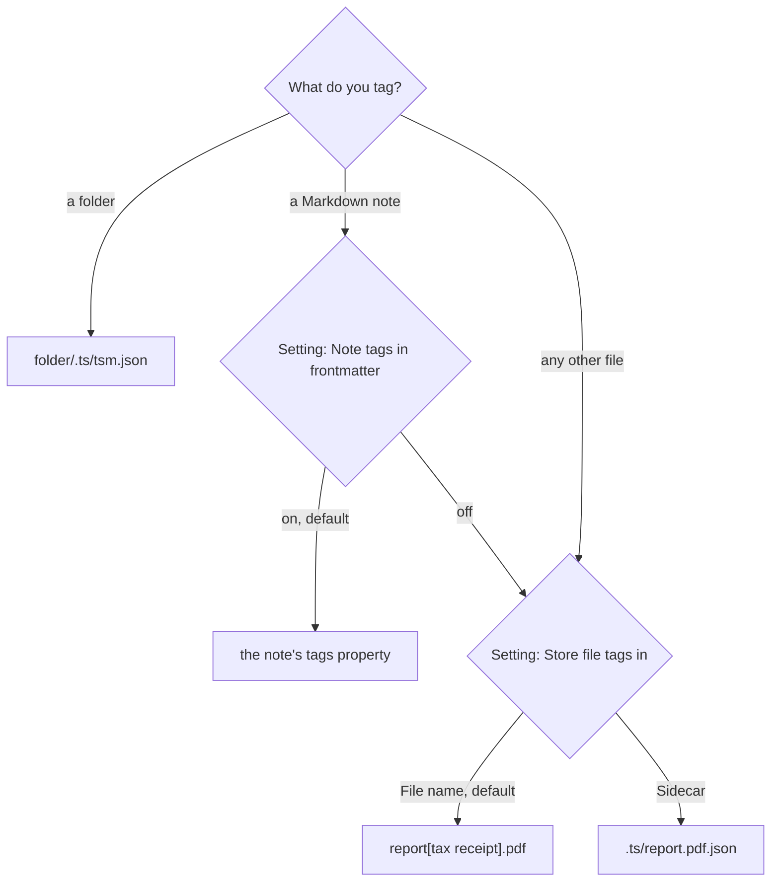
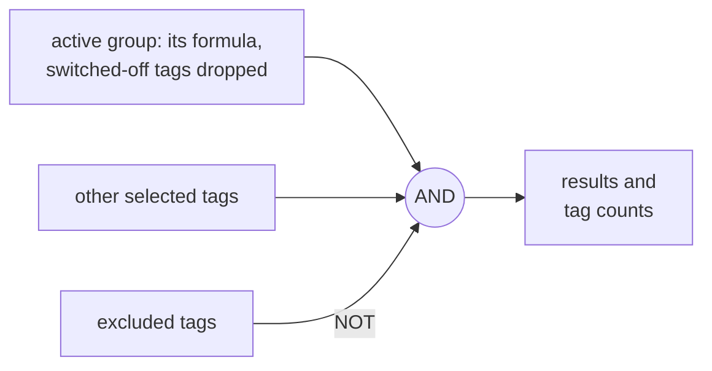

# TagEverything user guide

Tag any file or folder of your vault (notes, PDFs, Office files, images, folders), then find them again by their
tags. This guide covers every feature; the short version is in the [README](../README.md). The exact storage format
is in [format.md](format.md).

## 1. Where your tags are stored

Tags stay in your files, never in a private database, so other tag-aware file managers (TagSpaces) see them too.

| Item | Where new tags go | Example |
|---|---|---|
| Markdown note, **Note tags in frontmatter** on (default) | The note's `tags` property, as Obsidian stores it. The note is not renamed. | `tags: [b27, proj/alpha]` |
| Other file, **File name** (default) | First `[...]` group of the name, space-separated | `B27_Board_v10[b27 inc].docx` |
| Other file, **Sidecar** | `<folder>/.ts/<file name>.json` → `tags` | `.ts/B27_Board_v10.docx.json` |
| Folder (always) | `<folder>/.ts/tsm.json` → `tags` | `B27/.ts/tsm.json` |

Tags are always **read from every place and merged**: a note's tags are the tags in its name, plus its frontmatter
tags, plus its sidecar tags. A note named `budget[b27 inc].md` with `tags: [q3]` shows `b27 inc q3`. When you edit it,
the name tags you keep stay in the name and new tags go to the frontmatter. Folder names are never read for tags.
Other fields of a sidecar or `tsm.json` (id, description, colours…) and other note properties are kept.

## 2. Tag files and folders

- **Right-click → Edit tags** on a file or folder; on a multi-selection, **Edit tags of N items**; or the command
  *Edit tags of the current file*.
- Type a tag and press **Enter**, space or comma. Suggestions come from every tag of the vault, most used first.
- With several items, a tag only some of them carry shows as `3/5`: leave it (those items keep it), click it to give
  it to all, or remove it from all.
- A word that can't be a tag (e.g. `a:b`) stays in the box with the reason, so you can fix it. A nested tag
  (`proj/alpha`) is refused up front where it can't go (a file name); it works for notes.
- For a single file, the dialog previews the **new file name** before you save. Renames go through Obsidian, so
  **links in notes are updated**.
- Tagging more than 5 items shows its progress. If some fail, one notice lists why (the first 5, then how many more).
  Edits run one after the other: a second edit started before the first is written waits for it.

## 3. The tag naming rule

Setting *Tag naming rule*, on by default: a tag is **one lower-case plain word** (letters and digits, accents
allowed), never a liaison word (`de`, `la`, `the`, `of`…; the list is the setting *Liaison words*).

- Typed upper case is lower-cased.
- A compound is refused and its fix put in the box instead: `Tax-Receipt` → `tax receipt` (two tags); press **Enter**
  to accept.
- A liaison word is left out.
- Tags of the vault that break the rule aren't offered as suggestions.

The rule only applies to **new** tags. Existing ones stay until you run *Check tag names*.

## 4. Check tag names (fix the whole vault)

Command *Check tag names (naming rule) and fix them*, or *Settings → Tag maintenance → Check and fix tag names*.

1. It re-reads every tag (also those edited outside Obsidian).
2. It lists every tag that breaks the rule: how many items carry it, why, and a suggested fix (`B27` → `b27`,
   `plan_de_charge` → `plan charge`, `R&D` → `rd`, `de` → removed).
3. Edit a fix if you want (several tags: separate them with spaces; empty: the tag is removed), untick the ones to
   leave, then **Fix N tags**.
4. Each tag is rewritten **where it is**: in the file name (the file is renamed, links follow), the note's frontmatter
   or the sidecar. Tag groups (formulas included: `Tax-Receipt` becomes `tax AND receipt`), bookmark tabs and the
   panel's search follow.

Run it again to see what is left. A nested tag whose parent level holds several words (`my-proj/alpha`) has no
automatic fix: type one.

## 5. The File tags panel

Open it with the ribbon `tags` icon or the command *Open file tags panel*.

- Every tag with its count; frequently used tags are a little bigger (at most 1.4× the normal size).
- **Click tags** to list the files and folders carrying all of them (AND).
- **Right-click a tag → Exclude this tag (NOT)** to leave out the items carrying it (shown as `NOT tag`, struck
  through, at the top); right-click it again to search with it instead.
- **Filter tags**: type, then **Enter** selects the first match, **Escape** clears.
- **Results** work like the file explorer: click to open (Ctrl/Cmd-click or middle-click: new tab; non-note files open
  in their default app, folders are revealed), **Ctrl/Cmd + hover** for a page preview, **drag** one into a note to
  link it, right-click for the usual file menu.
- Everything works from the keyboard (Tab, then Enter or Space). The panel remembers its search, filter and tab
  across restarts.
- The ↻ button re-reads all tags (after editing them outside Obsidian).

## 6. Tag groups and formulas

Groups keep related tags together and double as saved searches.

- **+** creates a group from the current search (excluded tags become `NOT tag` in its formula), or drop a tag on
  **+**. **Drag** any tag onto a group to add it; a tag can be in several groups.
- Groups **fold** (chevron) and reorder by dragging one onto another. **⋯** or right-click: search, rename, edit the
  formula, add the selected tags, bookmark, delete (the tags stay on the files).
- Hover a tag of a group: **×** takes it out of the group, **⊘** excludes it from the group's search (`NOT tag`,
  struck through; click ↶ to include it again). Both are also in the tag's right-click menu.
- **A group is a search**: click its **Search** button (it shows how many items the group finds), its name, or
  *⋯ → Search with this group*. The button reads **Stop** while the search runs. The group's tags show at the top:
  click one to leave it out (dashed), click again to put it back; click other tags to narrow further. Click the group
  again, or **Clear**, to stop.
- **Formulas** (*⋯ → Combine with a formula*): any combination of the group's tags, e.g.
  `(b27 OR inc) AND (q3 OR 2026)`.
  - Operators `AND` / `OR` / `NOT`, also `ET` / `OU` / `NON` and `&` / `|` / `!`, and parentheses. Two tags side by
    side mean AND. `NOT` binds first, then `AND`, then `OR`.
  - Tag names complete as you type; the dialog shows the formula as it understood it and how many items it finds, or
    what is wrong.
  - A tag switched off during a group search drops out of its `OR` / `AND` as if it were not written, `NOT x`
    included. Dropping a tag on a group with a formula adds `AND tag`; its × removes it from the formula.
  - Empty the formula to go back to "all the tags". Tags match whatever the case; a tag in quotes may contain a
    parenthesis or be spelled like an operator (`"ou"`).
- Groups are saved in the plugin's settings (`.obsidian/plugins/tag-everything/data.json`), not in your files.

## 7. Bookmark tabs

Under the filter box: a tab **All** (every group and tag), then your own named tabs, e.g. *Work* and *Home*.

- **+** creates a tab (drop a tag or group on **+** to start the tab with it).
- Bookmark a tag or group by **dragging it onto a tab**, or right-click it → **Bookmark in the tab "…"** /
  **Bookmark in a new tab…**. **Remove from the tab "…"** takes it out (the tag stays on your files, the group stays
  in All).
- A tab shows only what is bookmarked in it. A group created with **+** while a tab is shown is bookmarked there.
- Right-click a tab to rename or delete it (deleting a tab deletes nothing else).
- The search is the same whatever the tab; the panel reopens on the tab you left. Tabs are saved with the groups.

## 8. Colours and explorer badges

- Each tag gets its own colour, picked from its name among the theme colours: always the same in the panel, the
  badges and the editor; nested tags share their parent's colour. A colour stored in a sidecar wins. With 8 colours,
  two tags can share one.
- **Badges** show tags next to names in the file explorer, in the tag colours; clicking one opens the panel on that
  tag. More tags than the limit show as `+N` (hover it to read them).

## 9. Commands and settings

| Command | What it does |
|---|---|
| Edit tags of the current file | Opens the tag editor on the active file |
| Open file tags panel | Shows the panel in the right sidebar |
| Check tag names (naming rule) and fix them | Section 4 |
| Re-read all tags (after editing them outside Obsidian) | Rebuilds the tag index and says how many items are tagged |

| Setting | Default | Effect |
|---|---|---|
| Store file tags in | File name | Where new tags of non-note files go: the name, or a `.ts` sidecar |
| Note tags in frontmatter | On | New tags of a note go to its `tags` property; the note is not renamed |
| Tag naming rule | On | Section 3 |
| Liaison words | French + English list | Words never used as tags while the rule is on; empty the box to restore the list |
| Lower-case new tags | Off | Only used while the naming rule is off (the rule implies it) |
| Move .ts metadata with renamed files | On | A file renamed or moved in Obsidian takes its sidecar and thumbnail along |
| Colour tags automatically | On | Section 8 |
| Show tag badges / Badges for / Maximum badges per item | On / All tags / 4 | Explorer badges (Section 8); *Badges for* can hide tags already readable in the name |
| Tag maintenance | | Buttons: *Check and fix tag names*, *Re-read all tags* |

The settings also show up in Obsidian's settings search (e.g. type "badges" or "sidecar").

## 10. Limits and troubleshooting

- **PDFs and Office files don't show up**: turn on *Settings → Files and links → Detect all file extensions*. Only
  files Obsidian has loaded can be tagged. Folders in *Excluded files* are still loaded (that setting only hides them
  from search).
- **Tags changed in another app don't show**: Obsidian does not watch `.ts` folders. Use *Re-read all tags* (panel ↻,
  command or settings), or *Check tag names* (it re-reads first); it also happens at each start. Name and frontmatter
  tags update live.
- **No badges**: they use the explorer's internal markup (no public API); an Obsidian update may hide them. Everything
  else keeps working.
- A file name is capped at 255 characters: tagging that would exceed it is refused. Tags cannot contain spaces or
  `[ ] # ^ | \ / : * ? " < >` (`/` is allowed for notes, as a nested tag).
- Only frontmatter tags of a note are read, not `#tags` written in its text (they are not checked by the naming rule
  either).
- A note whose frontmatter isn't valid YAML is left untouched: fix it in Obsidian first.
- Tags in a note's frontmatter aren't visible to other tag-aware file managers. Turn *Note tags in frontmatter* off
  to tag notes the same way as other files.
- Deleting a file in Obsidian leaves its `.ts` sidecar in place (metadata is never deleted unasked).
- Tag groups don't follow a tag renamed outside the panel (they keep the old name, shown faded); they do follow a
  *Check tag names* fix.
