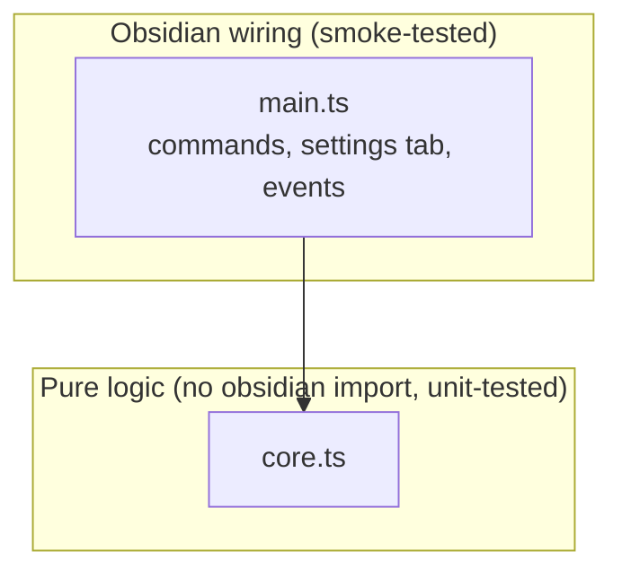

# __NAME__ architecture

How the plugin is built, for whoever maintains it. Users' view: [user-guide.md](user-guide.md). Invariants and
tests: [../CLAUDE.md](../CLAUDE.md).

## Layers

## Where data lives

| Data | Where | Read / written by |
|---|---|---|
| Settings | `.obsidian/plugins/__ID__/data.json` | `main.ts` `loadSettings` / `saveSettings` |

## Main flows

<!-- One Mermaid diagram (sequence or flowchart) per flow that touches user data or crosses modules. -->

## Module reference

| File | Role |
|---|---|
| `src/main.ts` | Plugin wiring: commands, settings tab, events. |
| `src/core.ts` | **Pure** logic, unit-tested, no `obsidian` import. |
